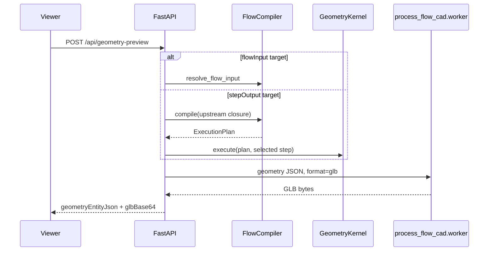
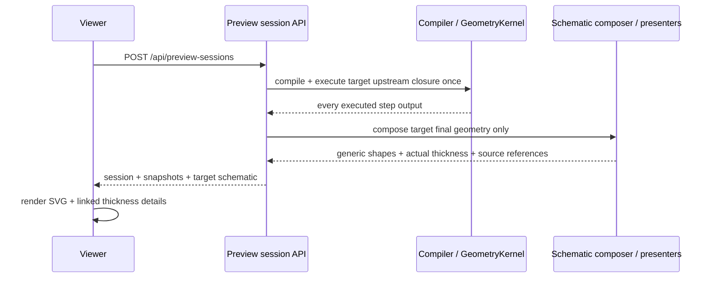

# Preview 與 export pipeline

Preview 與 file export 是兩條相關但不同的 runtime path。Legacy direct preview會compile/execute並同步
產生一份base64 GLB；current Geometry Preview UI改用semantic session。File export使用browser目前選取的
ready snapshot，不重新執行flow。

[ADR-0012](./decisions/0012-process-owned-schematic-preview.md) 將 Geometry Preview 改為 target-only
SVG schematic。ADR-0004 的 semantic session、upstream snapshots、content-addressed binary mesh
與 OCC exact body section API 保留；Flow Editor 不載入這些 CAD display assets。Legacy single-GLB
path 暫時保留供 compatibility。剩餘驗收見 [conformance](../conformance.md)。

## 現行同步 preview

`POST /api/geometry-preview` 接受：

- 一個 `flowInput` 或 `stepOutput` target；
- persisted `flowId` 與 inline `flow: {definition, configuration}` 必須恰好提供一個；
- optional `sourceLabel`。



Flow-input target 不執行 process modules。Step-output target 只 compile target upstream closure；不是 `GeometryKernel.execute_preview()`，目前沒有該 API。

GLB worker 由目前的 Python executable 以 `python -m process_flow_cad.worker` 啟動。
`GEOMETRY_PREVIEW_EXPORT_TIMEOUT_SECONDS`（default `30`）只控制同步 GLB preview
conversion helper path。Timeout 時 API 會終止 worker 並回傳 error。

此 path 沒有 session、跨 step asset reuse、body diff、binary mesh URL 或 section endpoint。
Legacy client 切換 step 會建立另一個 request 並重新 load 整份 GLB；current preview UI 不使用此 path。

## Semantic preview session

`POST /api/preview-sessions`沿用既有template/configuration/target validation。`stepOutput` target只執行
target upstream closure一次，session manifest保存每個已執行upstream step（含target）的snapshot；
`flowInput` target只保存resolved input snapshot。相同semantic request以content-derived `sessionId`在
bounded LRU中coalesce/reuse；切換snapshot不會再次compile/execute。



Endpoints：

| Endpoint | Contract |
| --- | --- |
| `POST /api/preview-sessions` | 建立／reuse ephemeral session、ordered upstream snapshots 與 target-only schematic。 |
| `GET /api/preview-sessions/{sessionId}/snapshots/{snapshotId}/mesh` | Lazy傳回以geometryHash/version cache的binary GLB；支援ETag/304。 |
| `GET /api/preview-sessions/{sessionId}/snapshots/{snapshotId}/section` | 依`axis=x\|y`、finite position與positive tolerance回傳OCC body regions；支援ETag/304。 |

每個 snapshot 包含 `geometryHash`、`geometryEntityJson`、`meshUrl`、`sectionUrl`、nullable `schematic`
與 `schematicWarnings`；只有 `initialSnapshotId` target 有 document。API 的 composition root 載入
step／generator companion presenters，kernel execution 不依賴它們。Viewer 不發 mesh／section
請求；這兩條 lazy routes 保留給工程 clients。

Schematic document 含版本、unit、通用 SVG shapes、source references、實際厚度明細與總厚度。
代表複製、顯示排列與薄層放大只存在 document，不修改 geometry 或 export。單一 presenter 失敗由
composer 退回通用圖形並提示；整體 composition 失敗以 null document／schematicWarnings 保留
semantic snapshot 與匯出功能。

Mesh cache key 是 `geometryHash + mesh cache version`；session/snapshot ids 另包含
request/contract、schematic 與 registry version。Geometry hash 不含 presentation 版本。Session JSON 不
inline base64 mesh。Mesh與section response使用`private, max-age=31536000, immutable`及content-derived
ETag；section strong ETag包含`snapshotId`，因此相同geometry的不同snapshot response不會共用validator。
Client送`If-None-Match`時可取得`304`。

Session是interaction resource，不是durable job或committed instance。Session、mesh與section都使用
entry/byte bounded process-memory LRU，並coalesce相同in-flight work；server restart或eviction後asset URL
會回`404`，client以原request重新POST session。Resolved OCC prepared model另使用entry-bounded LRU；同一
`geometryHash`的不同position reuse同一model，不再重做normalize、primitive conversion、overlap
validation、same-material union或parent/child subtraction。同一prepared model的section calls會序列化，
不同geometry仍可在global build concurrency範圍內平行執行。

Cache、execution與admission設定：

| Environment variable | Default | Responsibility |
| --- | ---: | --- |
| `PREVIEW_SESSION_CACHE_ENTRIES` / `PREVIEW_SESSION_CACHE_BYTES` | `16` / `134217728` | Session manifest LRU bounds。 |
| `PREVIEW_MESH_CACHE_ENTRIES` / `PREVIEW_MESH_CACHE_BYTES` | `64` / `268435456` | Binary GLB LRU bounds。 |
| `PREVIEW_SECTION_CACHE_ENTRIES` / `PREVIEW_SECTION_CACHE_BYTES` | `256` / `67108864` | Position-specific section JSON LRU bounds。 |
| `PREVIEW_PREPARED_SECTION_CACHE_ENTRIES` | `16` | Opaque resolved OCC model entry bound。 |
| `PREVIEW_SESSION_BUILD_CONCURRENCY` | `2` | Concurrent compile/execute session builds。 |
| `PREVIEW_MESH_BUILD_CONCURRENCY` | `2` | Concurrent GLB subprocess builds。 |
| `PREVIEW_SECTION_BUILD_CONCURRENCY` | `2` | Concurrent OCC prepare/section work across geometries。 |
| `PREVIEW_SESSION_INFLIGHT_LIMIT` | `32` | Unique session single-flight registry bound。 |
| `PREVIEW_MESH_INFLIGHT_LIMIT` | `32` | Unique mesh single-flight registry bound。 |
| `PREVIEW_SECTION_INFLIGHT_LIMIT` | `64` | Unique position section registry bound。 |
| `PREVIEW_PREPARED_SECTION_INFLIGHT_LIMIT` | `16` | Unique OCC preparation registry bound。 |

相同key在capacity已滿時仍會join既有single-flight task；只有新的unique work會收到`503`與
`Retry-After: 1`。Python `asyncio.to_thread`無法強制中止已進入native CAD code的thread，因此client
cancel只取消等待；server以bounded registries及concurrency避免slider unique positions無限排隊。

### 滿片 wafer 的執行成本與冷啟動量測

Kernel 複製已驗證的 `ProcessGeometryState` 時，以一次 normalized snapshot 固定 geometry IDs，
再複製內部物件樹，避免每次 clone 都經過 JSON hydration 與 polygon 重驗。Clone 排除 root 的外部
parent，重建 scope／handle，並隔離 geometry、provenance 與 footprint 等可變資料。手動共用 feature
或 geometry 物件、含重複座標陣列別名的結構保留原有 hydration 路徑。Step 回傳 `None` 或原本的
`context.state` 時重用該 execution-owned state；獨立回傳值與保存 runtime snapshot 時仍建立隔離副本。

Polygon validation／classification 共用 process-local、thread-safe LRU，以完整 normalized XYZ 座標與
數值型別作 key，只保存成功結果。上限為 128 筆與合計 100,000 vertices；超大項目直接計算。回傳的
loops／regions 每次建立獨立可變資料，座標變更使用新 key。原有相切、孔洞、容差與錯誤判定不變。
UF 的矩形標記以二分搜尋縮小網格範圍，再執行原有 strict midpoint 判斷；輪廓比較先排除 bounding
box 明確分離的候選。這些優化不進行座標 snapping，也不更改 snapshots、schematic 或 export 契約。

`scripts/benchmark_preview.py` 以唯讀方式讀取指定 SQLite DB，為每次 preview 啟動新的 Python process，
因此 session 與 polygon caches 都從空白開始。量測包含 prepare、execution／snapshots、schematic
planning／binding／composition；不含 interpreter startup、imports、正確性 capture 與 HTTP 傳輸。

```bash
venv/bin/python scripts/benchmark_preview.py \
  --db /absolute/path/to/process-flow.sqlite3 \
  --flow-name demo2 --target carrier_bond --runs 3 \
  --output /tmp/preview-baseline.json --capture /tmp/preview-baseline.json.gz
# 切換至優化版本後，以相同 DB 與 target 執行：
venv/bin/python scripts/benchmark_preview.py \
  --db /absolute/path/to/process-flow.sqlite3 \
  --flow-name demo2 --target carrier_bond --runs 3 \
  --output /tmp/preview-optimized.json --compare /tmp/preview-baseline.json
```

Report 保存各次及中位數耗時、分階段耗時、逐步 geometry hash，以及完整 provenance、execution
warnings、schematic 與 schematic warnings 的 hashes；`--compare` 遇到任何差異即失敗。`--capture`
另保存首次量測的完整 session 與 provenance，供逐欄檢查。也可將 `PYTHONPATH` 指向舊版 source archive，
在相同環境量測 baseline，避免修改工作中的 checkout。

2026-11-06 在同機器／Python 3.13，以 `5e46f755` source archive 比對本次優化，前後各三次冷啟動：

| 測量（中位數） | 原版 | 優化後 | 加速 |
| --- | ---: | ---: | ---: |
| `demo2`，32 steps／2,427 placements | 120.242 s | 53.473 s | 2.25× |
| 原始 `demo`，9 placements | 0.325 s | 0.241 s | 1.35× |
| UF，256 個錯位矩形，建網格＋ordered outlines | 4.343 s | 0.156 s | 27.78× |

`demo2` 三次原版為 118.765／120.242／120.910 s，優化後為 53.473／52.682／54.699 s。
Execution／snapshot materialization 的階段中位數為 111.715 → 43.973 s，target schematic composition
為 7.844 → 8.013 s。32 個逐步 geometry hashes、完整 provenance、execution warnings 與 schematic
全部一致，完整 session 與 JSON／CDB export 使用的 geometry 也逐欄相同，response 大小同為
19,404,881 bytes。這批合成配置符合至少 2× 的門檻；30 s 目標尚未達成，
後續須繼續降低完整 snapshots 的複製／正規化成本與 schematic composition 成本。

額外 profiling 確認，snapshot／provenance 路徑的 `deepcopy` 與 geometry 正規化仍是主要成本，
`with_runtime_state` 還會將剛取得的 provenance 寫回 clone。Polygon 首次驗證與分類也仍執行大量
segment／containment 比較；LRU 只省去相同座標的重複計算。後續可評估已固定 ID 的直接取用、
只在 lineage 實際合併時回寫 provenance，以及 polygon 首次計算的保守 bounding-box 排除。
這些方向尚未實作，需要額外的正確性與冷啟動驗證。Profiling 將 thread callbacks 改為 inline 以涵蓋
CPU 工作，其耗時含 instrumentation 成本，未納入上述三次效能驗收。

### Exact section

以下是保留 exact-section API 與 3D consumers 的工程契約，Flow Editor schematic preview 不執行此路徑。

Slider drag/debounce期間viewer先使用shader clipping，section card顯示`Computing`；140ms settle後請求
resolved CadBody shape的OpenCascade section。Response按body/material提供exact CAD area與closed 2D
`outer`/`holes` contours；viewer由同一response繪製3D caps、depth-tested material boundary outlines與
2D section。Curved contour polyline受request
tolerance控制。第一個query會prepare resolved bodies，後續position只建立section plane並對已保存的
shapes求交。Plane flip只改viewer保留哪一側，不改同一plane的section geometry。
Display clipping plane會依materialized model bounds使用小幅retained-side inset，cap offset再大於該
inset；因此requested plane上的既有tessellated cavity wall會被裁除，不會遮住exact cap。此epsilon只屬
display transform，不更動section request/response或CAD/export geometry，也不使用estimated feature bounds。
對極寬、極薄的package，2D engineering view可在presentation layer自動放大Z顯示比例並明示倍率；
此display transform不得回寫section response、影響CAD area或套用到3D geometry。

`PreviewSectionResponse.regions[]` 是strict contract：每個region包含`bodyId`、`sourceIds`、
`containerId/key`、`material`、`bodyKind`、nullable `featureType`、`approximationKind`、positive exact
`area`、closed `outer`與`holes`。每個2D point固定兩個finite numbers，loop至少四點且首尾相同；outer
逆時針、holes順時針。`containerKey`保留domain hierarchy value，root的合法empty key不得被response
validation拒絕。Current exact body section只產生`bodyKind: body`／`approximationKind: exact`，density
feature被排除。

Exact只修飾materialized body section。Via/circuit/bump仍是density envelope與estimated glyph/hatch，
不會因session或cap endpoint自動成為physical placement；UI必須標示`Estimated density`。

Viewer另依ADR-0005從snapshot GeometryStructure同步建立`EstimatedFeatureSectionLayer`。這個presentation
layer不進section response/cache key：plane與enabled feature envelope相交時，3D cross-section與2D SVG以
同一deterministic pattern model疊加；exact body loading/error不阻止estimated layer更新。

## 背景檔案 export

Viewer 可將同一份 ready snapshot 送到 `POST /api/geometry-preview/export-jobs`。Legacy alias
`POST /api/geometry-preview/cdb-jobs` 只建立 CDB job。

| 類型 | Input | 執行方式 |
| --- | --- | --- |
| `json` | `geometryEntityJson` | API process 直接寫 pretty JSON |
| `cdb` | `geometryStructure` + canonical `meshControl` | `mesher.process_flow.worker` subprocess |

CDB request不再接受頂層`elementSize`、`symmetry`或`modelType`。`meshControl`固定包含
`schemaVersion: "1.0.0"`、`unitSystem: "um"`、`mesher: "process_flow_2_5d"`、positive
`globalElementSize`、`symmetry`與`controls`。`symmetry`合法值為`full`、`upper_half`、
`right_half`、`upper_right_quarter`，所有欄位都必填。Job response以完整`meshControl`保存建立時的
設定；JSON的`meshControl`為`null`。通用route與CDB compatibility route都要求相同的
`kind: "cdb"`、`geometryStructure`、`meshControl`、`outputPath` body（另含browser `clientId`與optional
`sourceLabel`）。

Mesh-control schema的唯一完整source of truth在mesher package。API request model只要求`meshControl`
是JSON object；建立job前呼叫輕量的
`mesher.contracts.process_flow_2_5d.validate_mesh_control`（同時由`mesher.process_flow`公開re-export），
validator拒絕時轉成HTTP 422，不建立temp files或排入queue。Worker透過pipeline再次執行同一contract，
因此直接使用CLI也不會繞過驗證。API不得複製method/reference/location的Pydantic union。

Python-authored mesh control sets 位於 `packages/mesh-control-py`。API 可列出 set，或以當前
`geometryStructure` 套用 set，回傳完整 canonical `meshControl`、geometry hash 與規則解析說明。
套用 API 不建立 export job；前端可修改展開的設定，最後仍以原有 CDB job route 匯出。

每個CDB job建立獨立temp directory，輸入檔固定命名為`geometry.json`與`mesh_control.json`，並以
`mesher-process-flow geometry.json mesh_control.json output.cdb`等價的worker參數順序執行。Mesher啟動前，
API另將完整輸入以pretty JSON寫到CDB同目錄的`<stem>.geometry.json`與
`<stem>.mesh-control.json`；兩份sidecar不依賴mesh成功，CDB失敗或running job取消後仍會保留，且路徑由
job response的`geometryOutputPath`與`meshControlOutputPath`公開。成功、失敗與取消都只清除temp輸入檔
及目錄；cleanup warning與既有warning合併，不互相覆蓋。Job log記錄mesher、global element size、
symmetry、control count，以及兩份JSON輸入的hash與byte count。

Mesher-owned contract目前讓`controls` method支援`Z_SECTION_AVG`、`Z_SECTION_TOP`、`Z_SECTION_BOT`、
`Z_SECTION_CENTER`與`Z_POINT`。前四種要求`elementSize`、`startZ`、`endZ`；`Z_POINT`只要求`z`。
每筆control可帶選填的`label`描述用途；提供時必須是非空白字串，不影響mesh計算。舊資料可不帶此欄位，
`schemaVersion`仍為`1.0.0`。HBM範例set會將已套用規則的名稱寫入對應control。
Location可為relative `{ mode, anchor: z_min|z_max, offset }`或absolute `{ mode, value }`；任何relative
location都要求reference。Reference kind支援`root|container|body|via|circuit|bump`：root不得帶key/id，
其他kind至少要有一項；key只允許container/body。Mesher會解析reference與Z location，並在建立3D mesh
layers時套用local Z-plane controls。正常套用controls不產生job warning；worker diagnostics與cleanup
失敗等實際警告仍透過既有`warning`欄位回報。

Job state transition 是 `queued → running → success/failed`，取消路徑可經
`canceling → canceled`。Manager 預設同時執行三個 job（CDB、JSON 共用額度）；`EXPORT_MAX_CONCURRENT_JOBS`
優先於 legacy `CDB_EXPORT_MAX_CONCURRENT_JOBS`。每個 `clientId` 最多保留 20 個
terminal jobs。

Lifecycle status不承載內部pipeline細節；running job另回傳`progress`。JSON依序為
`preparing → writing_output → finalizing`，
CDB為`preparing → validating → analyzing_geometry → building_2d_mesh → building_3d_mesh →
writing_output → finalizing`。Circle imprint/extension屬於`building_2d_mesh`，沒有
`processing_features` stage。`current/total`只在worker能精確計數時提供，不代表整體job百分比。
Queued job另提供dynamic 1-based`queuePosition`；`runElapsedSeconds`在running時依現在時間計算。

Job list/get/cancel 以 browser-generated `clientId` filter。這是 UI isolation，不是 authentication；知道 client id 的 caller 可讀取或取消該 client jobs。

另有公開唯讀 `GET /api/dashboard/jobs`，提供所有 client 的 active jobs 原子快照與
running/queued counts，canceling 計入 running。它只公開 job ID、格式、狀態、時間、FIFO
順位、stage/count progress、allowlisted 細部動作說明與 `targetFolderPath`（輸出檔案的
parent directory，也是 `<jobId>.log` 所在資料夾，沿用已保存路徑、不解析 symlink）。
所有可存取 dashboard 的人皆可看到 target folder；省略 clientId、sourceLabel、其他 paths、meshControl
及任意 message/warning。耗時由 manager 的 monotonic clock 計算，快照不受 client history
筆數限制，terminal job 不列入。Viewer `/dashboard` 顯示此快照；完整契約見
[API README](../../apps/api/README.md) 與 [Dashboard](../ui/screens/dashboard.md)。

## 檔案寫入行為

Output path 必須是 absolute path、parent directory 必須已存在，extension 必須符合 kind。
Worker 先寫同一 directory 的 job temp file；成功時以 replace move 到 final path。若 final
path 已存在，job 開始時會先刪除。因此 caller 必須把 endpoint 視為 server-side file
write/replace capability。

每個accepted job會先在output directory以exclusive create建立`<jobId>.log`。這是line-buffered
plain-text sidecar，API response以`logPath`公開路徑；相同output path的不同job不會覆寫彼此log。
Log永久保留，不隨20筆in-memory history pruning或API restart刪除，也沒有自動retention。
建立log失敗時request不會被接受；執行期間log寫入失敗會使job失敗。

Worker以`PROCESS_FLOW_PROGRESS `prefix在stderr傳送JSON事件；API同步drain stdout/stderr、更新
public progress並寫sidecar。這個structured worker contract不會直接出現在log。Sidecar開頭集中列出
log schema、job/type、paths與input摘要；timeline只使用`HH:MM:SS.mmm: action — comment`，相同的
連續comment只寫一次，且不重複記錄item event的metadata。結尾集中列出status、total time、output與
mesh統計；failure才附上exception、return code、diagnostic與traceback。非協定stderr轉成timeline
diagnostic。Log不保存完整geometry payload、mesh connectivity或逐node/element資料。

Input temp files 會在 terminal state cleanup。CDB的geometry與mesh-control JSON output sidecars不屬於
temp files，因此不會隨terminal cleanup刪除。Cleanup 失敗以 job `warning` 回報。

## Timeout、重啟與取消

背景 CDB jobs 目前沒有 hard timeout；`GEOMETRY_PREVIEW_EXPORT_TIMEOUT_SECONDS` 不適用。
取消 running subprocess 時會呼叫 terminate，但不提供 cross-process durable recovery。

Jobs、queue 與 history 都在 API process memory：

- restart 後 job history 消失；
- shutdown 會取消 queued jobs 並 terminate running jobs；
- 不應把此 manager 當 durable queue。

## Export 語意

CAD worker normalize structure 後支援 Box、Polygon、Cylinder、Cone。GLB 只包含 materialized body solids。CDB 使用 2.5D mesher，其 primitive 與 feature semantics 較窄，詳見 [geometry-semantics.md](../concepts/geometry-semantics.md)。

Session display assets同樣只authoritative表示materialized bodies。Future display LOD不得改變body/material
identity；engineering section精度由BRep exact section path負責，不由display mesh triangle density決定。

## 失敗契約

Worker non-zero exit、missing output 或 conversion error 會轉成 API/job message；stderr 優先且
只保留尾端作為精簡public error。完整diagnostic、exception type、traceback與return code寫入
per-job plain-text summary。同步 preview error 是 HTTP error；背景 error 保存在 job status與sidecar log。

Session request的invalid output port回`400`；invalid section axis／non-positive tolerance由request
validation回`422`；missing／evicted session或unknown snapshot asset回`404`。Mesh/section conditional GET
命中ETag時回`304`且無body。Session/asset generation failure是HTTP error，不建立durable failure record。
