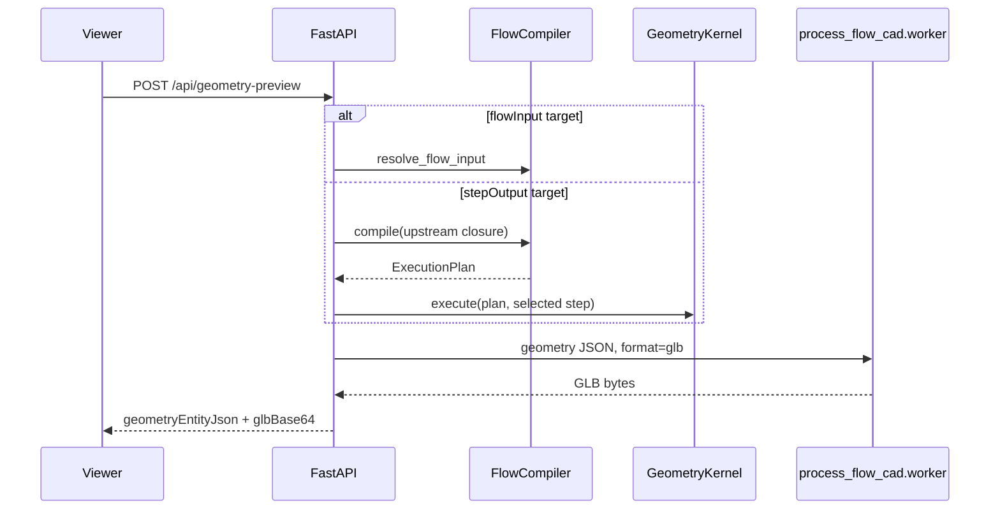
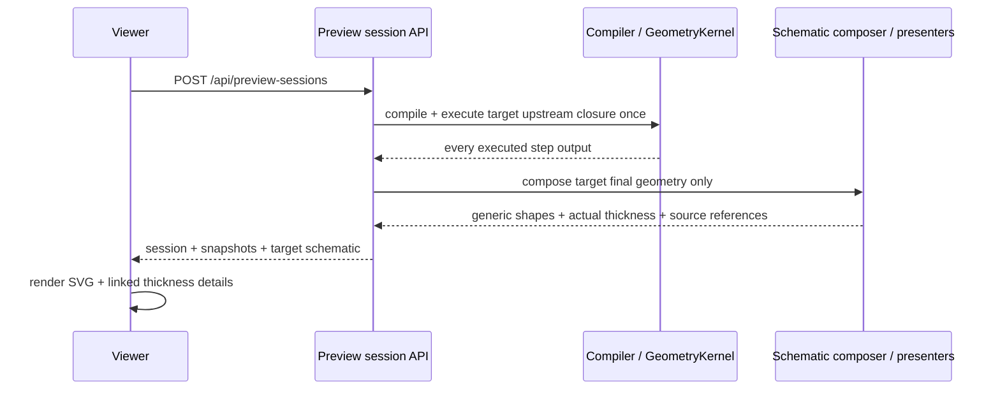

# Preview 與 export pipeline

Preview 與 file export 是兩條相關但不同的 runtime path。Legacy direct preview會compile/execute並同步
產生一份base64 GLB；current Geometry Preview UI改用semantic session。File export使用browser目前選取的
ready snapshot，不重新執行flow。

[ADR-0012](./decisions/0012-process-owned-schematic-preview.md) 將 Geometry Preview 改為 target-only
SVG schematic。ADR-0004 的 semantic session、upstream snapshots、content-addressed binary mesh
與 OCC exact body section API 保留；Flow Editor 不載入這些 CAD display assets。Legacy single-GLB
path 暫時保留供 compatibility。剩餘驗收見 [conformance](../conformance.md)。

## 現行同步 preview

`POST /api/geometry-preview` 接受：

- 一個 `flowInput` 或 `stepOutput` target；
- persisted `flowId` 與 inline `flow: {definition, configuration}` 必須恰好提供一個；
- optional `sourceLabel`。



Flow-input target 不執行 process modules。Step-output target 只 compile target upstream closure；不是 `GeometryKernel.execute_preview()`，目前沒有該 API。

GLB worker 由目前的 Python executable 以 `python -m process_flow_cad.worker` 啟動。
`GEOMETRY_PREVIEW_EXPORT_TIMEOUT_SECONDS`（default `30`）只控制同步 GLB preview
conversion helper path。Timeout 時 API 會終止 worker 並回傳 error。

此 path 沒有 session、跨 step asset reuse、body diff、binary mesh URL 或 section endpoint。
Legacy client 切換 step 會建立另一個 request 並重新 load 整份 GLB；current preview UI 不使用此 path。

## Semantic preview session

`POST /api/preview-sessions`沿用既有template/configuration/target validation。`stepOutput` target只執行
target upstream closure 一次；上游 snapshots 僅暫時供 provenance／layout binding 使用。Session manifest
只保留並回傳選中的 target snapshot，`snapshots` 長度固定為 1，`initialSnapshotId` 指向該筆；
`flowInput` target 同樣只保存 resolved input snapshot。相同 semantic request 以 content-derived `sessionId`
在 bounded LRU 中 coalesce/reuse；切換 target 另 POST session，上游執行由 step cache 共用。



Endpoints：

| Endpoint | Contract |
| --- | --- |
| `POST /api/preview-sessions` | 建立／reuse ephemeral session，只回傳 target snapshot 與 schematic。 |
| `GET /api/preview-sessions/{sessionId}/snapshots/{snapshotId}/mesh` | Lazy傳回以geometryHash/version cache的binary GLB；支援ETag/304。 |
| `GET /api/preview-sessions/{sessionId}/snapshots/{snapshotId}/section` | 依`axis=x\|y`、finite position與positive tolerance回傳OCC body regions；支援ETag/304。 |

每個 snapshot 包含 `geometryHash`、`geometryEntityJson`、`meshUrl`、`sectionUrl`、nullable `schematic`
與 `schematicWarnings`；唯一的 target snapshot 有 document。API 的 composition root 載入
step／generator companion presenters，kernel execution 不依賴它們。Viewer 不發 mesh／section
請求；這兩條 lazy routes 保留給工程 clients。

Schematic document 含版本、unit、通用 SVG shapes、source references、實際厚度明細與總厚度。
代表複製、顯示排列與薄層放大只存在 document，不修改 geometry 或 export。單一 presenter 失敗由
composer 退回通用圖形並提示；整體 composition 失敗以 null document／schematicWarnings 保留
semantic snapshot 與匯出功能。

Mesh cache key 是 `geometryHash + mesh cache version`；session/snapshot ids 另包含
request/contract、schematic 與 registry version。Geometry hash 不含 presentation 版本。Session JSON 不
inline base64 mesh。Mesh與section response使用`private, max-age=31536000, immutable`及content-derived
ETag；section strong ETag包含`snapshotId`，因此相同geometry的不同snapshot response不會共用validator。
Client送`If-None-Match`時可取得`304`。

Session是interaction resource，不是durable job或committed instance。Session、mesh與section都使用
entry/byte bounded process-memory LRU，並coalesce相同in-flight work；server restart或eviction後asset URL
會回`404`，client以原request重新POST session。Resolved OCC prepared model另使用entry-bounded LRU；同一
`geometryHash`的不同position reuse同一model，不再重做normalize、primitive conversion、overlap
validation、same-material union或parent/child subtraction。同一prepared model的section calls會序列化，
不同geometry仍可在global build concurrency範圍內平行執行。

Cache、execution與admission設定：

| Environment variable | Default | Responsibility |
| --- | ---: | --- |
| `PREVIEW_STEP_CACHE_ENABLED` | `true` | 跨 session 共用上游執行結果；可用 `false` / `0` 停用。 |
| `PREVIEW_STEP_CACHE_ENTRIES` / `PREVIEW_STEP_CACHE_BYTES` | `256` / `268435456` | Step LRU 同時限制 entry 數與完整 runtime/provenance 保留量。 |
| `PREVIEW_STEP_CACHE_INFLIGHT_LIMIT` | `32` | 不同 step key 的計算上限；超限執行但不保留。 |
| `PREVIEW_SESSION_CACHE_ENTRIES` / `PREVIEW_SESSION_CACHE_BYTES` | `16` / `134217728` | Session manifest LRU bounds。 |
| `PREVIEW_MESH_CACHE_ENTRIES` / `PREVIEW_MESH_CACHE_BYTES` | `64` / `268435456` | Binary GLB LRU bounds。 |
| `PREVIEW_SECTION_CACHE_ENTRIES` / `PREVIEW_SECTION_CACHE_BYTES` | `256` / `67108864` | Position-specific section JSON LRU bounds。 |
| `PREVIEW_PREPARED_SECTION_CACHE_ENTRIES` | `16` | Opaque resolved OCC model entry bound。 |
| `PREVIEW_SESSION_BUILD_CONCURRENCY` | `2` | Concurrent compile/execute session builds。 |
| `PREVIEW_MESH_BUILD_CONCURRENCY` | `2` | Concurrent GLB subprocess builds。 |
| `PREVIEW_SECTION_BUILD_CONCURRENCY` | `2` | Concurrent OCC prepare/section work across geometries。 |
| `PREVIEW_SESSION_INFLIGHT_LIMIT` | `32` | Unique session single-flight registry bound。 |
| `PREVIEW_MESH_INFLIGHT_LIMIT` | `32` | Unique mesh single-flight registry bound。 |
| `PREVIEW_SECTION_INFLIGHT_LIMIT` | `64` | Unique position section registry bound。 |
| `PREVIEW_PREPARED_SECTION_INFLIGHT_LIMIT` | `16` | Unique OCC preparation registry bound。 |

相同key在capacity已滿時仍會join既有single-flight task；只有新的unique work會收到`503`與
`Retry-After: 1`。Python `asyncio.to_thread`無法強制中止已進入native CAD code的thread，因此client
cancel只取消等待；server以bounded registries及concurrency避免slider unique positions無限排隊。

### 滿片 wafer 的執行成本與冷啟動量測

`PreviewSessionManager` 擁有程序內共用的 step cache。切換 target、修改無關下游或 preview
`sourceLabel` 時，先完成該 target 的 compile/validation，再重用內容 key 相同的上游 artifact。
完整 session/schematic hash 仍包含 flow context，因此示意圖仍反映目前設定。

Kernel 使用唯一的不可變 snapshot capture/restore 路徑：命中不 clone、不 hydrate、不準備材料；
未命中建立該步驟擁有的可變 state，執行後一次正規化與 snapshot capture。Runtime snapshot
保留 cursor/footprint/creation metadata；外部 JSON 仍完整驗證。Provenance 來源紀錄可安全共用。
API 以 `step_artifact()` 傳遞內部快照，JSON getter/response 回傳獨立資料。架構與失效規則見
[kernel internals](../reference/kernel/internals.md)。

Reset/shutdown 增加 cache generation；已排入或執行中的舊 worker 不能寫回新 generation。
Step cache 的容量估算包含 runtime、provenance、key 與 entry overhead，超大單筆直接略過；
32 個 in-flight slots 額滿時正常執行，不使 preview 失敗。這與 session/mesh 的 503 admission 契約不同。

Polygon 完整驗證集中於外部入口；正規化座標及 lazy 外框／孔洞索引由不可變 `PolygonSnapshot`
保存，取代全域 polygon LRU。Underfill、copy、snapshot、Joint、PnP adapter、內部 mesh control
規則以及 artifact 消費路徑不重驗。原始 mesh-control 文件仍在外部入口驗證。
Schematic context 的可選 `polygon_lookup(node_id)` 由 API 注入，schematic 套件不依賴 kernel。
獨立 composition 使用 raw structure 時，由 presenter 在該次 composition 解析並共用一次。
Preview 內部僅保留 node-ID 對應的唯讀 polygon 資料，供 schematic 及 lazy CAD section 建立
artifact 使用，不重複保留整棵 runtime tree，也不傳入 HTTP JSON。Session 容量估算包含新增
資料，共用載體只計算一次；step cache 估算也預留 lazy 分類索引的空間。
UF 的矩形標記以二分搜尋縮小網格範圍，再執行原有 strict midpoint 判斷；輪廓比較先排除 bounding
box 明確分離的候選。這些優化不進行座標 snapping，也不更改 snapshots、schematic 或 export 契約。

`scripts/benchmark_preview.py` 以唯讀方式讀取指定 SQLite DB，為每次 preview 啟動新的 Python process，
因此 session、step cache 與 polygon 分類索引都從空白開始。`--step-cache off`（預設）量測無快取冷執行，
`cold` 量測建立 step cache 的成本，`warm` 先建立完整 target，再量測五個不同上游 target；
可用 `--warm-targets` 明確指定至少五個不同 target，避免誤測整份 session cache。量測分開回報
kernel、snapshot materialization、schematic planning／binding／composition 與完整 preview；不含 interpreter startup、imports、正確性 capture 與 HTTP 傳輸。
另外回報完整 polygon 驗證次數／累計耗時／輪廓與頂點數、underfill Region／幾何建立／snapshot
時間與 peak RSS。`scripts/benchmark_polygon_runtime.py` 提供大量 die／孔洞的獨立合成案例，
同樣支援三次新 process 與 off/cold/warm；正確性驗證在計時結束後執行。

```bash
venv/bin/python scripts/benchmark_preview.py \
  --db /absolute/path/to/process-flow.sqlite3 \
  --flow-name demo2 --target carrier_bond --runs 3 \
  --output /tmp/preview-baseline.json --capture /tmp/preview-baseline.json.gz
# 切換至優化版本後，以相同 DB 與 target 執行：
venv/bin/python scripts/benchmark_preview.py \
  --db /absolute/path/to/process-flow.sqlite3 \
  --flow-name demo2 --target carrier_bond --runs 3 \
  --output /tmp/preview-optimized.json --compare /tmp/preview-baseline.json
```

Report 保存各次及中位數耗時、分階段耗時、逐步 geometry hash，以及完整 provenance、execution
warnings、schematic 與 schematic warnings 的 hashes；`--compare` 遇到任何差異即失敗。`--capture`
另保存首次量測的完整 session 與 provenance，供逐欄檢查。也可將 `PYTHONPATH` 指向舊版 source archive，
在相同環境量測 baseline，避免修改工作中的 checkout。若歷史版本尚無 step-cache 介面，使用
該 archive 自己的 benchmark script；缺少 kernel 分段的舊 report 仍可比對完整 preview 與正確性 hashes。

2026-11-06 在同機器／Python 3.13，以 `5e46f755` source archive 比對本次優化，前後各三次冷啟動：

| 測量（中位數） | 原版 | 優化後 | 加速 |
| --- | ---: | ---: | ---: |
| `demo2`，32 steps／2,427 placements | 120.242 s | 53.473 s | 2.25× |
| 原始 `demo`，9 placements | 0.325 s | 0.241 s | 1.35× |
| UF，256 個錯位矩形，建網格＋ordered outlines | 4.343 s | 0.156 s | 27.78× |

`demo2` 三次原版為 118.765／120.242／120.910 s，優化後為 53.473／52.682／54.699 s。
Execution／snapshot materialization 的階段中位數為 111.715 → 43.973 s，target schematic composition
為 7.844 → 8.013 s。32 個逐步 geometry hashes、完整 provenance、execution warnings 與 schematic
全部一致，完整 session 與 JSON／CDB export 使用的 geometry 也逐欄相同，response 大小同為
19,404,881 bytes。這批合成配置符合至少 2× 的門檻；30 s 目標尚未達成，
後續須繼續降低完整 snapshots 的複製／正規化成本與 schematic composition 成本。

### 上游快取與 snapshot 重構驗收（2026-11-09）

以工作區基準 `3ca3d46f`（開始實作時無未提交修改）保存 source archive 與唯讀 SQLite backup，
前後各三次新 Python 3.13 process。這一輪保留既有 schematic/UF 演算法，與上述前一輪分開比較。
完整數據見 [step-cache-benchmark.json](../reference/kernel/step-cache-benchmark.json)。

| 情境 | 修改前 | 修改後 | 結果 |
| --- | ---: | ---: | --- |
| demo2，關閉 step cache，kernel 中位數 | 40.097 s | 9.004 s | 4.45×；達到至少 2× |
| demo2，關閉 step cache，完整 preview 中位數 | 54.078 s | 21.338 s | 2.53× |
| demo，關閉 step cache，kernel 中位數 | 187.309 ms | 29.828 ms | 6.28× |
| demo，關閉 step cache，完整 preview 中位數 | 239.077 ms | 74.795 ms | 沒有小型案例退步 |
| demo2，啟用 step cache 的冷執行單次樣本 | — | kernel 11.314 s／preview 23.967 s | 含完整 retained-size 計算與寫入 |
| 五個不同上游 target，全命中 kernel 中位數 | — | 30.217 ms | 五次均執行 0 個步驟；小於 1 s |

暖快取 targets 是 `mr_joint_2`、`pnp_5`、`under_fill`、`molding_2`、`grinding_2`，避免重複使用
同一 session。預設容量下保留 32 entries、222,863,390 bytes（212.54 MiB），142 hits、32 misses、
0 evictions、0 in-flight；大小包含 runtime、provenance 與 entry overhead，跨 entry 的共用資料
保守重複計入。來源使用固定欄位 frozen dataclass，避免每筆 source reference 的 dict 開銷。

Demo2 與 demo 全部 32 個步驟的 geometry、IDs、完整 provenance、warning 內容/順序及 schematic
hashes 一致；完整 session/provenance JSON 也逐欄一致，JSON/CDB export 的 geometry 輸入相同。
另外把原有 kernel 測試擷取出的 34 組成功結果/錯誤，分別在修改前 archive 與修改後的 cache off、
cold、warm 模式執行，結果完全相同。五個暖快取 target 的 schematic 另與 archive 各自執行的
結果比較一致。沒有使用座標容差放寬比對。

新增 23 個 cache/preview 測試（含 19 個 subtests），涵蓋 prefix reuse、局部失效、合流警告順序、
完整外部 artifact 身分、return modes、JSON 隔離、相同 key 並行、失敗重試、容量/淘汰、oversize、
reset generation 與反覆編輯後的引用釋放。Kernel 237、process steps 53、schematic 97、generators 31
項測試通過；API 330 通過，5 個失敗與獨立 baseline 相同：兩個 mesher failure 預期不符、一個
`mesher.process_flow.pipeline` 不存在，以及 schema 11/13 的既有 migration fixture hash 差異。

```bash
venv/bin/python scripts/benchmark_preview.py \
  --db /absolute/path/to/process-flow.sqlite3 \
  --flow-name demo2 --target carrier_bond --runs 1 --step-cache warm \
  --output /tmp/preview-warm.json --compare /tmp/preview-baseline.json
```

完整 preview 仍包含 schematic 與 JSON materialization 成本；30 ms 僅代表全命中 kernel，
不包含 schematic 或 HTTP。預設快取是每個 API process 各自擁有，重啟會清空。

### Polygon 驗證邊界驗收（2026-11-09）

基準是本次修改開始時的工作樹備份，包含先前未提交的 step-cache 重構。
macOS arm64／Python 3.13；每種情境三個新 process，取中位數。Demo2 使用相同唯讀 DB
快照與 `carrier_bond` target，共 32 個 snapshots。合成案例包含 576 顆 die、485 條輪廓、
2,300 個頂點。完整分階段數值、逐次結果、輸出 hashes 與正規化 ID 差異見
[polygon-runtime-benchmark.json](../reference/kernel/polygon-runtime-benchmark.json)。

| 情境／項目 | 修改前 | 修改後 |
| --- | ---: | ---: |
| Demo2，關閉 step cache，完整 preview | 21.438 s | 14.157 s |
| Demo2，關閉 step cache，underfill | 4.284 s | 1.162 s |
| Demo2，underfill Region 計算 | 1.156 s | 1.143 s |
| Demo2，underfill 其餘幾何建立／放置 | 3.127 s | 0.018 s |
| Demo2，啟用 step cache 冷執行，完整 preview | 24.154 s | 16.759 s |
| Demo2，五個上游 target 暖快取 preview（共 15 次） | 3.733 s | 3.178 s |
| 576 die，無快取 kernel + schematic | 7.247 s | 2.794 s |
| 576 die，無快取 underfill | 2.502 s | 0.433 s |
| 576 die，啟用 step cache 冷執行，kernel + schematic | 7.308 s | 2.825 s |
| 576 die，暖快取 kernel + schematic | 86.43 ms | 84.09 ms |

Demo2 的冷啟動完整 polygon 驗證從 2 次（734 條輪廓／5,720 個頂點，累計 6.749 s）降至 0；
合成案例從 2 次降至 0。Warm 路徑連驗證函式呼叫也為 0，沒有依靠舊全域 LRU 命中。
每個 warm target 分別比較三次中位數，皆符合 preview 不退步超過 5% 的門檻。
Region 演算法保持不變，現在佔 underfill 的主要時間。

| Peak RSS 中位數（MiB） | 修改前 | 修改後 |
| --- | ---: | ---: |
| Demo2，無 step cache | 488.33 | 488.33 |
| Demo2，step cache 冷啟動 | 583.53 | 641.56 |
| Demo2，預熱及五個 warm target 後 | 879.66 | 867.28 |
| 576 die，無 step cache | 74.98 | 73.98 |
| 576 die，step cache 冷啟動 | 77.92 | 76.42 |
| 576 die，warm 後 | 80.41 | 79.62 |

RSS 是整個 process 的 high-water mark，包含 Python allocator 保留的記憶體；啟用 step cache
的冷啟動樣本增加約 58 MiB，沒有以無快取數據掩蓋這項差異。Session 僅保留共用 polygon
查詢資料，避免完整 artifact 的重複保留及容量估算造成 warm preview 退步。

所有情境的幾何（包含材料與 IDs）、provenance、execution warnings 及 schematic hashes
均與基準相同。完全重複及容差內重複閉合點另有 fixture，保存頂點由 5 個變成 4 個；
明確 ID 保留，衍生 ID／hash 的預期差異列於報告。沒有批次改寫資料庫。
CAD 測試確認體積、bounds、孔洞與原始輸入一致；演算法輸出在計時外經完整驗證。

Kernel 241、steps 53、schematic 97、mesh control 85、generators 31 個測試通過；
API 全套 293 個測試仍有與基準相同的 4 failures／1 error（CDB/mesher 與 migration digest），
另外 5 個 polygon consumer 測試全部通過。Docs、PnP golden example 與 diff whitespace 檢查通過。
Kernel cache 與 preview session／mesh／section cache 版本已更新。

```bash
venv/bin/python scripts/benchmark_polygon_runtime.py \
  --side 24 --runs 3 --mode off --output /tmp/polygon-before.json
# 同樣比較 cold / warm；正確性驗證不計入執行時間。
venv/bin/python scripts/benchmark_polygon_runtime.py \
  --side 24 --runs 3 --mode off --output /tmp/polygon-after.json \
  --compare /tmp/polygon-before.json
```

### 單一 target 與 UF 簡化示意（2026-11-09）

Session 只建立 target 的 record、geometry hash、下載資料與 payload deepcopy；不保留上游 HTTP
snapshot records。內部 upstream execution／binding 與 step cache 保留。Target 的完整累積幾何、
JSON／CDB 匯出輸入及 warnings 不受精簡 response 影響。

UF companion 以 mounting region 宣告 layer fill，當前可見的非 Wafer DMY 元件依顯示順序連接；
空白預留 slot 不阻斷，Wafer DMY 不作端點、不跨越其 slot，不同 region 不互連。
不要求實際 gap body，也不查詢 XY 距離、孔洞、連通區或接觸。初始高度取已執行 UF 輸入的
runtime cursor 與 recipe `thk`；沿來源傳遞／複製，套用 flip 的 Z 轉換與 grinding 的實際切削平面。
純 geometry standalone composition 僅畫保留 UF slab，不推導接觸。

製程補畫的 item 帶 `measurementSource: "process"`、`sourceStepRefId`，Inspector 標示「示意厚度」。
`sourceIds` 只包含當前真實 geometry IDs；沒有實際 UF body 時為空。實際 cavity slab 維持 geometry
厚度，總厚度僅由實際 geometry 計算。舊 `bridge_groups`／`eligible_container_ids` 契約及實體連通
composer 路徑已移除。完整數據見 [single-target-preview-benchmark.json](../reference/kernel/single-target-preview-benchmark.json)。

同一份唯讀 `demo2`／`carrier_bond`，前後各三個新 process 的中位數：

| 項目 | 修改前 | 修改後 |
| --- | ---: | ---: |
| 啟用 step cache 的冷 preview | 17.070 s | 9.990 s |
| Target schematic composition | 5.990 s | 0.204 s |
| 五個不同 target 的暖 preview（15 次中位數） | 3.744 s | 1.135 s |
| HTTP snapshot 數 | 32 | 1 |
| Response bytes | 19,405,115 | 2,596,959 |

修改後冷／暖 payload deepcopy 中位數為 35.83／36.07 ms，相同 session 再開的中位數為 0.503 s。
32 個上游步驟 geometry、provenance、execution warnings hashes 全部一致；target
`geometryEntityJson` 與 JSON／CDB 使用的 geometry structure 逐欄一致。Schematic 按新規則改變，
沒有以舊示意圖 hash 相等作為驗收。Kernel 冷執行仍約 8.35 s，為目前冷 preview 的主要剩餘成本。

Benchmark 的 `checks.geometry`／provenance／execution warnings 從內部所有已執行 snapshots 計算，
HTTP snapshots 另要求固定為 1；warm targets 也從內部 execution 選取。刻意變更 schematic 時，
使用 `--compare-execution-only --compare <baseline.json>`，仍逐步檢查所有執行結果；預設 compare
繼續比較 schematic。結果另列 payload deepcopy、session cache hit 與 response bytes，不含 HTTP／瀏覽器時間。

### Exact section

以下是保留 exact-section API 與 3D consumers 的工程契約，Flow Editor schematic preview 不執行此路徑。

Slider drag/debounce期間viewer先使用shader clipping，section card顯示`Computing`；140ms settle後請求
resolved CadBody shape的OpenCascade section。Response按body/material提供exact CAD area與closed 2D
`outer`/`holes` contours；viewer由同一response繪製3D caps、depth-tested material boundary outlines與
2D section。Curved contour polyline受request
tolerance控制。第一個query會prepare resolved bodies，後續position只建立section plane並對已保存的
shapes求交。Plane flip只改viewer保留哪一側，不改同一plane的section geometry。
Display clipping plane會依materialized model bounds使用小幅retained-side inset，cap offset再大於該
inset；因此requested plane上的既有tessellated cavity wall會被裁除，不會遮住exact cap。此epsilon只屬
display transform，不更動section request/response或CAD/export geometry，也不使用estimated feature bounds。
對極寬、極薄的package，2D engineering view可在presentation layer自動放大Z顯示比例並明示倍率；
此display transform不得回寫section response、影響CAD area或套用到3D geometry。

`PreviewSectionResponse.regions[]` 是strict contract：每個region包含`bodyId`、`sourceIds`、
`containerId/key`、`material`、`bodyKind`、nullable `featureType`、`approximationKind`、positive exact
`area`、closed `outer`與`holes`。每個2D point固定兩個finite numbers，loop至少四點且首尾相同；outer
逆時針、holes順時針。`containerKey`保留domain hierarchy value，root的合法empty key不得被response
validation拒絕。Current exact body section只產生`bodyKind: body`／`approximationKind: exact`，density
feature被排除。

Exact只修飾materialized body section。Via/circuit/bump仍是density envelope與estimated glyph/hatch，
不會因session或cap endpoint自動成為physical placement；UI必須標示`Estimated density`。

Viewer另依ADR-0005從snapshot GeometryStructure同步建立`EstimatedFeatureSectionLayer`。這個presentation
layer不進section response/cache key：plane與enabled feature envelope相交時，3D cross-section與2D SVG以
同一deterministic pattern model疊加；exact body loading/error不阻止estimated layer更新。

## 背景檔案 export

Viewer 可將同一份 ready snapshot 送到 `POST /api/geometry-preview/export-jobs`。Legacy alias
`POST /api/geometry-preview/cdb-jobs` 只建立 CDB job。

| 類型 | Input | 執行方式 |
| --- | --- | --- |
| `json` | `geometryEntityJson` | API process 直接寫 pretty JSON |
| `cdb` | `geometryStructure` + canonical `meshControl` | `mesher.process_flow.worker` subprocess |

CDB request不再接受頂層`elementSize`、`symmetry`或`modelType`。`meshControl`固定包含
`schemaVersion: "1.0.0"`、`unitSystem: "um"`、`mesher: "process_flow_2_5d"`、positive
`globalElementSize`、`symmetry`與`controls`。`symmetry`合法值為`full`、`upper_half`、
`right_half`、`upper_right_quarter`，所有欄位都必填。Job response以完整`meshControl`保存建立時的
設定；JSON的`meshControl`為`null`。通用route與CDB compatibility route都要求相同的
`kind: "cdb"`、`geometryStructure`、`meshControl`、`outputPath` body（另含browser `clientId`與optional
`sourceLabel`）。

Mesh-control schema的唯一完整source of truth在mesher package。API request model只要求`meshControl`
是JSON object；建立job前呼叫輕量的
`mesher.contracts.process_flow_2_5d.validate_mesh_control`（同時由`mesher.process_flow`公開re-export），
validator拒絕時轉成HTTP 422，不建立temp files或排入queue。Worker透過pipeline再次執行同一contract，
因此直接使用CLI也不會繞過驗證。API不得複製method/reference/location的Pydantic union。

Python-authored mesh control sets 位於 `packages/mesh-control-py`。API 可列出 set，或以當前
`geometryStructure` 套用 set，回傳完整 canonical `meshControl`、geometry hash 與規則解析說明。
套用 API 不建立 export job；前端可修改展開的設定，最後仍以原有 CDB job route 匯出。

每個CDB job建立獨立temp directory，輸入檔固定命名為`geometry.json`與`mesh_control.json`，並以
`mesher-process-flow geometry.json mesh_control.json output.cdb`等價的worker參數順序執行。Mesher啟動前，
API另將完整輸入以pretty JSON寫到CDB同目錄的`<stem>.geometry.json`與
`<stem>.mesh-control.json`；兩份sidecar不依賴mesh成功，CDB失敗或running job取消後仍會保留，且路徑由
job response的`geometryOutputPath`與`meshControlOutputPath`公開。成功、失敗與取消都只清除temp輸入檔
及目錄；cleanup warning與既有warning合併，不互相覆蓋。Job log記錄mesher、global element size、
symmetry、control count，以及兩份JSON輸入的hash與byte count。

Mesher-owned contract目前讓`controls` method支援`Z_SECTION_AVG`、`Z_SECTION_TOP`、`Z_SECTION_BOT`、
`Z_SECTION_CENTER`與`Z_POINT`。前四種要求`elementSize`、`startZ`、`endZ`；`Z_POINT`只要求`z`。
每筆control可帶選填的`label`描述用途；提供時必須是非空白字串，不影響mesh計算。舊資料可不帶此欄位，
`schemaVersion`仍為`1.0.0`。HBM範例set會將已套用規則的名稱寫入對應control。
Location可為relative `{ mode, anchor: z_min|z_max, offset }`或absolute `{ mode, value }`；任何relative
location都要求reference。Reference kind支援`root|container|body|via|circuit|bump`：root不得帶key/id，
其他kind至少要有一項；key只允許container/body。Mesher會解析reference與Z location，並在建立3D mesh
layers時套用local Z-plane controls。正常套用controls不產生job warning；worker diagnostics與cleanup
失敗等實際警告仍透過既有`warning`欄位回報。

Job state transition 是 `queued → running → success/failed`，取消路徑可經
`canceling → canceled`。Manager 預設同時執行三個 job（CDB、JSON 共用額度）；`EXPORT_MAX_CONCURRENT_JOBS`
優先於 legacy `CDB_EXPORT_MAX_CONCURRENT_JOBS`。每個 `clientId` 最多保留 20 個
terminal jobs。

Lifecycle status不承載內部pipeline細節；running job另回傳`progress`。JSON依序為
`preparing → writing_output → finalizing`，
CDB為`preparing → validating → analyzing_geometry → building_2d_mesh → building_3d_mesh →
writing_output → finalizing`。Circle imprint/extension屬於`building_2d_mesh`，沒有
`processing_features` stage。`current/total`只在worker能精確計數時提供，不代表整體job百分比。
Queued job另提供dynamic 1-based`queuePosition`；`runElapsedSeconds`在running時依現在時間計算。

Job list/get/cancel 以 browser-generated `clientId` filter。這是 UI isolation，不是 authentication；知道 client id 的 caller 可讀取或取消該 client jobs。

另有公開唯讀 `GET /api/dashboard/jobs`，提供所有 client 的 active jobs 原子快照與
running/queued counts，canceling 計入 running。它只公開 job ID、格式、狀態、時間、FIFO
順位、stage/count progress、allowlisted 細部動作說明與 `targetFolderPath`（輸出檔案的
parent directory，也是 `<jobId>.log` 所在資料夾，沿用已保存路徑、不解析 symlink）。
所有可存取 dashboard 的人皆可看到 target folder；省略 clientId、sourceLabel、其他 paths、meshControl
及任意 message/warning。耗時由 manager 的 monotonic clock 計算，快照不受 client history
筆數限制，terminal job 不列入。Viewer `/dashboard` 顯示此快照；完整契約見
[API README](../../apps/api/README.md) 與 [Dashboard](../ui/screens/dashboard.md)。

## 檔案寫入行為

Output path 必須是 absolute path、parent directory 必須已存在，extension 必須符合 kind。
Worker 先寫同一 directory 的 job temp file；成功時以 replace move 到 final path。若 final
path 已存在，job 開始時會先刪除。因此 caller 必須把 endpoint 視為 server-side file
write/replace capability。

每個accepted job會先在output directory以exclusive create建立`<jobId>.log`。這是line-buffered
plain-text sidecar，API response以`logPath`公開路徑；相同output path的不同job不會覆寫彼此log。
Log永久保留，不隨20筆in-memory history pruning或API restart刪除，也沒有自動retention。
建立log失敗時request不會被接受；執行期間log寫入失敗會使job失敗。

Worker以`PROCESS_FLOW_PROGRESS `prefix在stderr傳送JSON事件；API同步drain stdout/stderr、更新
public progress並寫sidecar。這個structured worker contract不會直接出現在log。Sidecar開頭集中列出
log schema、job/type、paths與input摘要；timeline只使用`HH:MM:SS.mmm: action — comment`，相同的
連續comment只寫一次，且不重複記錄item event的metadata。結尾集中列出status、total time、output與
mesh統計；failure才附上exception、return code、diagnostic與traceback。非協定stderr轉成timeline
diagnostic。Log不保存完整geometry payload、mesh connectivity或逐node/element資料。

Input temp files 會在 terminal state cleanup。CDB的geometry與mesh-control JSON output sidecars不屬於
temp files，因此不會隨terminal cleanup刪除。Cleanup 失敗以 job `warning` 回報。

## Timeout、重啟與取消

背景 CDB jobs 目前沒有 hard timeout；`GEOMETRY_PREVIEW_EXPORT_TIMEOUT_SECONDS` 不適用。
取消 running subprocess 時會呼叫 terminate，但不提供 cross-process durable recovery。

Jobs、queue 與 history 都在 API process memory：

- restart 後 job history 消失；
- shutdown 會取消 queued jobs 並 terminate running jobs；
- 不應把此 manager 當 durable queue。

## Export 語意

CAD 同一行程的 convert/export/section 入口接受 artifact 或原始 structure；artifact 直接使用
polygon 資料，原始 structure 在入口解析一次。CAD worker 仍由 JSON 檔跨行程傳輸，新 worker
載入時驗證一次，沒有跨行程信任旗標。支援 Box、Polygon、Cylinder、Cone；GLB 只包含
materialized body solids。CDB 使用 2.5D mesher，其 primitive 與 feature semantics 較窄，詳見
[geometry-semantics.md](../concepts/geometry-semantics.md)。

Session display assets同樣只authoritative表示materialized bodies。Future display LOD不得改變body/material
identity；engineering section精度由BRep exact section path負責，不由display mesh triangle density決定。

## 失敗契約

Worker non-zero exit、missing output 或 conversion error 會轉成 API/job message；stderr 優先且
只保留尾端作為精簡public error。完整diagnostic、exception type、traceback與return code寫入
per-job plain-text summary。同步 preview error 是 HTTP error；背景 error 保存在 job status與sidecar log。

Session request的invalid output port回`400`；invalid section axis／non-positive tolerance由request
validation回`422`；missing／evicted session或unknown snapshot asset回`404`。Mesh/section conditional GET
命中ETag時回`304`且無body。Session/asset generation failure是HTTP error，不建立durable failure record。
