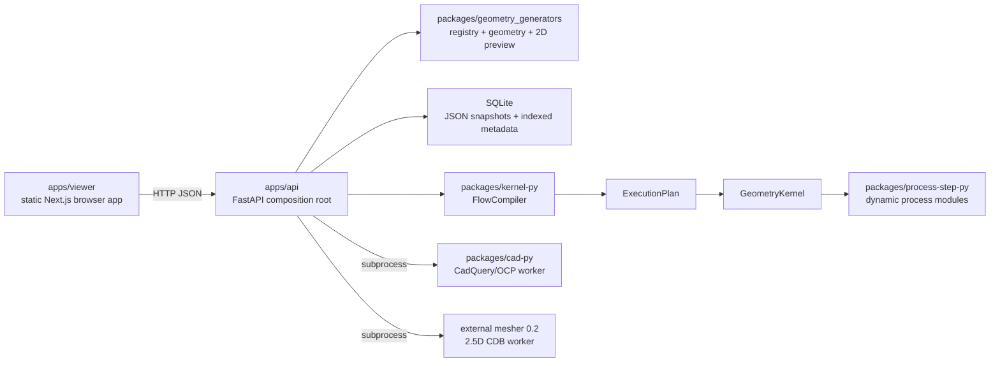

# 系統架構總覽

Process Flow 是 local-first PoC，由 static Next.js viewer、FastAPI/SQLite service、pure-Python process kernel，以及隔離的 CAD/mesher workers 組成。

## Container 視圖

## 套件職責

| 套件 | 負責 | 不負責 |
| --- | --- | --- |
| `apps/viewer` | Browser interaction、generic generator/2D preview renderer、working editor state、HTTP clients、3D presentation | Generator engineering logic、canonical persistence、kernel execution rules |
| `apps/api` | HTTP contract、generator 註冊組裝、Pydantic request/response validation、SQLite persistence/transactions、resource orchestration、export job lifecycle | Generator 與 process-step geometry operations |
| `packages/geometry_generators` | Versioned generator manifest、registry、具體實作、engineering preview 與 materialization cache | HTTP、SQLite、API application |
| `packages/kernel-py` | Geometry domain、flow validation/compiler、execution plan、step execution、normalization | SQLite、HTTP、CadQuery、frontend state |
| `packages/process-step-py` | Concrete `execute(context)` operation modules | Persistence、API routing、module discovery policy |
| `packages/cad-py` | Geometry-to-CadQuery conversion、GLB、STEP AP242 | Flow compilation、catalog resolution |
| external `mesher` 0.2 | Standard structure to 2.5D mesh/text CDB | Flow compilation、catalog resolution |

Dependency direction 是 `viewer → API → kernel`，API 也依賴獨立的 geometry generator package，並在 `create_app` 明確註冊啟用的實作。API 另外啟動CAD與external mesher workers；
kernel在execution time動態import process-step modules；CAD與mesher process-flow extra使用kernel
的geometry contract。Kernel不依賴API或storage。

## 核心 runtime flow

### Resource CRUD 流程

FastAPI 的 strict Pydantic models 會拒絕 unknown fields。Service 驗證 domain constraints
後，`SQLiteStore` 把 canonical camelCase JSON 存入 `payload` column，並另外保存 list/query
metadata。現行 flow API 統一為 `/api/process-flows`，完整 topology/configuration 可 CAS 更新。草稿統一為 `/api/process-flow-drafts`。

### Compile 與 execute

API 載入 flow 自有 definition/configuration 及 step templates。Compiler 先選出採用 recipe，進行 dependency pruning 和完整度驗證，再解析 catalog／generator inputs，產生已解析 ExecutionPlan。Kernel 只執行 plan，不讀 recipe 候選或 repository。

### Editor draft commit

草稿保存畫布與完整 configuration。Commit 在同一交易檢查 draft／target flow revision、建立或更新 flow 並刪草稿；失敗保留原資料。正式保存驗證拓樸與已提供值，不執行 generator 或 kernel。

### Preview 與 export

Preview 可以直接解析 flow input，或只執行 step output 的 upstream closure。API 接著啟動
短生命週期的 CAD worker 產生 GLB。背景 JSON/STEP/CDB export job 使用已 ready 的 snapshot，
不重新 compile。完整行為與操作限制見
[Preview 與 export pipeline](./preview-export-pipeline.md)。

## Persistence 與生命週期

業務 SQLite schema 14 使用 canonical JSON 加查詢欄位。已知 8–13 格式經一致性備份後在單一交易升級；unknown／schema 15 拒絕且不 reset。所有 flows 的 (name, version) 唯一。舊 template／instance 及草稿轉換、embedded geometry 保留與失敗回滾詳見 [Persistence](../reference/persistence.md)。

Export job 是 process-local memory state，不是 SQLite resource。API shutdown 會取消 queued／
running jobs；restart 後 history 會消失。

## 部署邊界

Viewer 使用 `output: "export"`；`NEXT_PUBLIC_PROCESS_FLOW_API_BASE_URL` 會在 build time 寫入
browser JavaScript。API CORS 必須包含 static host origin。

現行 service 沒有 authentication 或 authorization。`POST /api/reset` 具有破壞性，export
endpoints 可寫入／取代 server-side absolute path，而 `clientId` 只做 list isolation，不是
security identity。這些 endpoints 只適合受信任的 local environment；對外部署前必須另做
security design。
