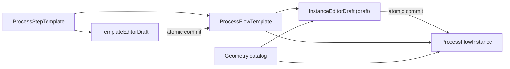

# Process Flow 產品模型

Process Flow 把「可重用的製程定義」、「研究中的配置」與「已保存的產品配置」分開管理。
這個分離是目前實作的核心，不應由 UI 畫面或 SQLite table 形狀反向定義。

## 角色與資源

| 資源 | 用途 | 可變性 | 主要 owner |
| --- | --- | --- | --- |
| `ProcessStepTemplate` | 定義一個 process operation 的 geometry ports、parameters 與 `program` | identity/port definitions/parameter contract locked；owner/category/program/input order/defaults 可更新 | Process developer |
| `ProcessFlowTemplate` | 定義 flow inputs、step references、directed topology 與 flow-specific scalar defaults | identity/version/topology locked；metadata/defaults 可受限更新 | Process developer |
| `TemplateEditorDraft` | 保存未完成的 topology、working configuration 與畫布位置 | revision-checked 可修改，正式儲存後刪除 | Process developer |
| `InstanceEditorDraft` | 保存未完成的 geometry bindings 與 parameter values | 可修改直到正式儲存後刪除；以 `revision` optimistic concurrency 控制 | Product / RD engineer |
| `ProcessFlowInstance` | 保存完整且可執行的產品配置 | Immutable | Product / RD engineer |
| `GeometryEntity` | Catalog 中可被 flow input 引用的 geometry document | 建立後 immutable | Geometry producer |

`ProcessFlowTemplate` 定義 topology 與建立空白 instance 時使用的 flow-specific scalar
defaults，不保存產品 geometry selection 或已完成 recipe configuration。`ProcessFlowInstance`
與 `InstanceEditorDraft` 都 reference template；configuration 分別放於正式 record 與草稿的 `state.configuration`。

## 生命週期

### Template 編輯

Flow template 的 step reference 綁定既有 step template。Topology 的執行順序由 `flowEdges` 推導，而不是由 `stepRefs` array order 決定。建立 template 前，API 會解析所有 referenced step templates 並驗證 graph。

Process step update 保留相同 identity、port definitions 與 parameter definition contract，只允許管理 metadata、
program path、input port order 與 parameter defaults。Input order決定接口與上游分支由上到下的排列，
既有引用在重新載入時採用新順序；接線與geometry執行仍以portId和role解析。Flow template 在建立時保存自己的 scalar defaults，因此 step
default update 只影響之後建立的 flow；program update 則會由相同 step id 的後續執行直接解析。

### Editor draft 流程

Template draft 保存拓樸、metadata、完整 working configuration 與畫布位置；instance draft 保存指定 template 下的 metadata 與完整 configuration。兩種 snapshot 分別存於獨立資料表。User/name 是草稿資訊，不改寫正式 owner/name。

Save Draft 允許未完成或有語意驗證錯誤的編輯狀態；更新檢查 revision。From Draft 恢復 snapshot，不重新套用 defaults。正式儲存用目前 editor payload 通過原本的完整驗證後，同一 transaction 建立正式 resource、materialize 必要 geometry 並刪除草稿。失敗 rollback 且保留草稿。

## Compile 與 execute 邊界

`FlowCompiler` 是 external resource 與 executable plan 的邊界。它負責 graph/configuration validation、catalog/embedded geometry resolution、normalization，以及 preview target 的 upstream closure。輸出是完整的 `ExecutionPlan`。

`GeometryKernel` 只接收 `ExecutionPlan`，不查 SQLite、不解析 catalog id。它依 topological order 執行 process modules，並回傳 selected geometry、每個 step output 與 terminal step ids。

## 範圍

目前支援兩種 editor draft 的 create/list/load/update/delete/commit、正式 template/instance create、execute、preview 與 export。Instance 不提供 overwrite 或 lineage。舊 workspace 僅存在 migration 與歷史說明，不提供 runtime API。
