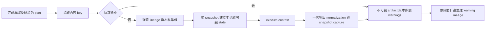

# Geometry Kernel 內部架構

Kernel 採用 domain/application/infrastructure/serialization 分層。這是 code organization，不是 network service boundary。

## 分層

| Layer | Responsibility |
| --- | --- |
| `domain` | Geometry primitives、features、container tree、`ProcessGeometryState` operations |
| `application` | Graph validation、configuration normalization、resource-to-plan compilation、plan execution、material instance preparation |
| `infrastructure` | 將 template `program` 解析為 Python module |
| `serialization` | Structure normalization、stable ids、hydrate/serialize bridge |
| `utils` | Polygon classification/validation 與 math helpers |

Kernel 不 import FastAPI、SQLite 或 API Pydantic models。

## Graph 分析

`analyze_flow_graph` 建立 id maps、incoming-edge map、topological order 與 terminal ids。Validation enforce：

- unique flow input、step ref、edge、port 與 parameter ids；
- referenced template/port 存在且 data type 相符；
- required input port exactly one incoming edge；
- no multiple incoming edges、self edge、cycle；
- every declared flow input connected；
- current step output fan-out limit 是 one consumer。

Topological queue 初始順序來自 `stepRefs` insertion order；只有 dependency order 是 contract，independent nodes 的 relative order不應被 consumer 當成 semantic guarantee。

## Compiler

`FlowCompiler` 先 analyze graph，再依 draft/complete mode normalize values。Complete compile 會 resolve resources，檢查 geometry constraints，並把每個 input route 轉成 `PlannedGeometryInput`。

Preview output 指定時，compiler 計算 upstream step closure，只要求該 closure 使用到的 bindings/parameters。External structure 在 plan 建立前 normalize，因此 kernel execution 不需 id resolution。

## 執行流程

Kernel 依 plan order 計算每個步驟的 execution key。只有明確宣告正整數
`EXECUTION_CACHE_VERSION`、使用標準 module resolver、且所有相依來源都可快取的步驟可重用。
一般 `GeometryKernel()` 不啟用快取；注入 `StepExecutionCache` 後仍使用相同 `_execute_step`。

`GeometryArtifact` 擁有唯讀 geometry、provenance、generation/adaptation metadata，以及可選的
`RuntimeGeometrySnapshot`。Snapshot 保存原始 runtime 座標、穩定 IDs、cursor、footprint、
provenance creation step/ordinal；內部使用 frozen dataclass、唯讀 mapping 與 tuple。
外部 JSON artifact 的 `runtime_snapshot` 是 `None`，PnP 因而保留原有 placement 高度語意。

`ProcessGeometryState.clone()` 統一走 snapshot capture/restore。Restore 排除外部 parent、重建
scope/handle，並逐個 occurrence 建立可變 geometry wrapper。Polygon wrapper 共用不可變座標，
move/flip/clip 建立新座標載體，保持副本隔離；其他 primitive 仍複製可變座標。
來源紀錄使用固定欄位的 frozen dataclass，保留唯讀 Mapping 存取，避免每筆來源持有一個 dict；
未改變的紀錄可共用，新增來源建立新紀錄。Provenance getter/setter 不再序列化整棵 geometry。

`GeometryArtifact.geometry()` 與 execution result 的 JSON getters 每次回傳獨立 dict/list。
API 內部使用 `step_artifact()` 取得不可變快照，只在 JSON 邊界 materialize。Process module 的
`context.geometry_inputs` 仍是本次執行擁有的 JSON；修改它不會污染其他步驟或 cache。

### 快取身分、容量與生命週期

Key 使用含型別資訊的確定性內容編碼與 SHA-256，包含 kernel/module cache version、完整
step template、ID/label、原始及正規化參數、output port、有順序的輸入 port/來源身分及 upstream key。
External artifact 另包含 geometry、provenance、runtime cursor/footprint/creation metadata 與
來源/generation/adaptation descriptor。Preview target/sourceLabel 與無關下游不進 step key。
Session/schematic identity 仍保留完整 flow context。

`MemoryStepExecutionCache` 與 API/storage 解耦；預設 256 entries / 256 MiB，同時限制、LRU
淘汰、超大單筆略過。容量估算包含完整 runtime、provenance 與 entry overhead；不同 entries
共用的不可變資料保守重複計入。估算以 dataclass 欄位的所有權優先於 Mapping view，
避免僅計入 artifact 的 geometry 而漏算 runtime/provenance。未宣告版本的步驟、custom resolver/importer 與相依下游不快取。

相同 key/generation 使用 Future 共用一次成功或失敗的計算。Factory、等待與大小估算均在鎖外；
不同 key 最多 32 個 in-flight，額滿走正常未快取執行。只保留成功結果；失敗時已成功上游仍可重用。
每個 entry 只存本步驟 warnings，每次按目前 plan 重建 warning occurrence lineage，維持合流去重與順序。

`clear()` 增加 generation 並清空保留項目。Preview 在排入 worker 前擷取 generation，經
`cache_generation` 傳入 kernel；reset/shutdown 後的舊 worker 不能回填新 generation。
直接同步 kernel 呼叫預設在 execute 開始取得 generation。API manager 擁有 cache，沒有全域 mutable cache。

`execution_statistics()` 回報執行/重用步數，以及 identity、cache/wait、input preparation、
process execution、snapshot 和 kernel 耗時；cache `info()` 回報 hits/misses/waits/evictions/
bypasses、entries、bytes 與 in-flight 數。這些診斷資訊不加入 preview HTTP response。

## Material instance 準備

Runtime 會 strip terminal `_dup<number>`、計算 primary state 中每個 base material 的最大 instance index，然後對本 step 新 material 配置 next name。Auxiliary geometry 與 nested `fieldGroupArray` 中的 `materialRef` 也會重寫。

這個流程發生在 module 執行前，但 `raw_parameter_values` 仍保留原始 configuration。

## Hydration 與 serialization

`normalize_geometry_structure` 在數值正規化遍歷中建立獨立 input 副本，補 schema/unit/container collections，並為缺少 id 的 container/features建立 SHA-1 based deterministic ids。Hydration 建立 parent pointers 與 scope cache；serialization輸出 plain JSON，不保存 Python parent reference。

### Polygon 驗證邊界

`parse_polygon_structure()` 在外部載入時先以 `PolygonSnapshot.from_external()` 正規化並完整驗證
每個 polygon，再補齊缺少的 ID。正規化保存既有容差規則移除閉合重複點的結果，沒有新增取整、
方向調整或輪廓排序；明確指定的 ID 保留，衍生 ID/hash 可以因此改變。API 負責欄位與有限數值，
kernel 負責共面、重複點、自交、面積及輪廓交叉。JSON 沒有可略過驗證的旗標。

`PolygonGeometry` 只持有一個不可變 `PolygonSnapshot`，由 runtime snapshot 與 artifact 的
`polygons[node_id]` 共用。外框／孔洞分類按需保存為不可變索引，生命週期跟隨座標；不再有全域
驗證／分類 LRU、座標 key、鎖與淘汰。Copy、getter、改厚度、snapshot capture/restore、平移、
Z flip 與內部分類不執行完整拓樸驗證。座標及 JSON getters 仍回傳獨立 list/dict。

Region、underfill、裁切與 PnP adapter 的限定內部入口 `_from_generated()` 僅正規化座標。
裁切仍保留退化面積移除、輪廓拆分和方向正規化；測試以完整驗證器獨立檢查輸出。
Polygon footprint 保存相同載體，建立 layer/via/circuit/bump 時只改 Z。材料／ID 重映射沿用
polygon 資料；公開 `artifact.with_structure()` 視為新外部輸入，會重新驗證。

`Geometry.bounds()` 與 feature 的 `bounds()` 直接讀取幾何；container bounds 不再先複製
geometry。Underfill 的 bump 高度只讀取 `z_min()`／`z_max()`。外框／孔洞分類與 Region 幾何
運算仍是必要成本，這次沒有重寫 Region 網格演算法。

Clone 必須重建 parent/cache，不共享 mutable geometry objects。若新增 domain collection，需同步更新 clone、move、flip、clip、serialize、hydrate 與 traversal tests。

## Geometry operation

Domain geometry classes負責 primitive-level move/clip/flip/copy。`Container` 負責 subtree traversal。`ProcessGeometryState` 提供 process-oriented facade、cursor、footprint 與 scope resolution。

`clip_xy_to_box` 回傳 retained geometry，允許 clipping 將 primitive 轉成另一種 geometry；沒有正面積交集時回傳 `None`。Polygon clipping 使用 Shapely/GEOS boolean intersection 與 `1e-5 um` precision grid，支援凹形、holes、multiple hulls，以及裁切後分裂為多個 islands；line/point-only intersection 與面積不大於 `1e-5 um²` 的退化 fragment 會移除。完全包含的 Polygon 保留原始 coordinates 與 loop order，partial 結果則 deterministic canonicalize 為 outer CCW、hole CW。

Cylinder saw 支援兩種 exact 結果：保留框包含整圓時維持 Cylinder，保留框四角都位於圓內時轉成 Box。其他穿越圓周的部分裁切仍不支援，Cone 也維持既有限制。

Process module不應直接依賴 `Container` internal arrays；否則 cursor/footprint/cache invariant 可能失效。

## 已知內部限制

- Exception types/messages 尚未形成 versioned public hierarchy。
- Module resolution 是 in-process dynamic import，沒有 isolation。
- `process_flow_kernel.__init__` export surface 偏大；「exported」不等於 long-term stable。
- Geometry schema validation 分散在 hydration/domain/consumer，尚無單一 machine-readable schema gate。

過去 aspirational API 設計已移至 [geometry-kernel-target-api.md](../../archive/rfcs/geometry-kernel-target-api.md)，不得用它判斷 current behavior。
