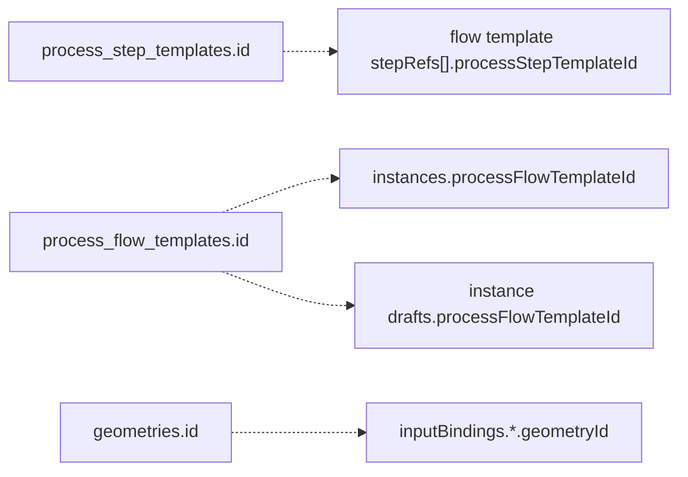

# Persistence

本文件是 [Process Flow 資料模型](../data-model.md) 的 normative persistence
reference，定義 SQLite physical storage、logical references、immutability、transactions、
internal schema marker 與未發行階段的 reset policy。

## 1. 儲存模型

Process Flow 使用單一 SQLite database。每個 resource table 保存：

1. Canonical camelCase JSON in `payload`；
2. 少量 denormalized columns，供 primary key、filter、sort 與 concurrency control；
3. indexes，不把完整 domain model正規化成多張 relational child tables。

`payload` 是 read response 的 domain source；denormalized columns MUST 與 payload 在同一
transaction 保持一致。Direct database edits 不屬於 supported API。

## 2. 實體 tables

### 2.1 `process_step_templates`

| Column | SQLite type | Constraint | Payload path |
| --- | --- | --- | --- |
| `id` | `TEXT` | primary key | `id` |
| `name` | `TEXT` | not null | `name` |
| `category` | `TEXT` | not null, indexed | `category` |
| `version` | `TEXT` | not null | `version` |
| `owner` | `TEXT` | not null | `owner` |
| `payload` | `TEXT` | not null | complete JSON |

### 2.2 `process_flow_templates`

| Column | SQLite type | Constraint | Payload path |
| --- | --- | --- | --- |
| `id` | `TEXT` | primary key | `id` |
| `name` | `TEXT` | not null | `name` |
| `version` | `TEXT` | not null | `version` |
| `owner` | `TEXT` | not null | `owner` |
| `payload` | `TEXT` | not null | complete JSON |

### 2.3 `process_flow_instances`

| Column | SQLite type | Constraint | Payload path |
| --- | --- | --- | --- |
| `id` | `TEXT` | primary key | `id` |
| `name` | `TEXT` | not null | `name` |
| `process_flow_template_id` | `TEXT` | not null, indexed | `processFlowTemplateId` |
| `payload` | `TEXT` | not null | complete JSON |

### 2.4 Editor draft tables

`process_flow_template_drafts` 與 `process_flow_instance_drafts` 分開保存各自型別的 snapshot；不共用 payload model。

| Column | SQLite type | Payload path |
| --- | --- | --- |
| `id` | TEXT primary key | `id` |
| `user`, `name` | TEXT not null | `user`, `name` |
| `revision` | INTEGER not null | `revision` |
| `created_at`, `updated_at` | TEXT not null | `createdAt`, `updatedAt` |
| `payload` | TEXT not null | complete draft JSON |
| `process_flow_template_id` | TEXT not null; instance table only | `processFlowTemplateId` |

Both tables index user and updated time; instance drafts also index template ID. List endpoints return summaries without state. JSON contains a separate `state.metadata` and `state.configuration`; template state additionally contains nodes, edges and viewport.

### 2.5 `geometries`

| Column | SQLite type | Constraint | Payload path |
| --- | --- | --- | --- |
| `id` | `TEXT` | primary key | `id` |
| `name` | `TEXT` | not null | `name` |
| `category` | `TEXT` | nullable, indexed | `category` |
| `entity_type` | `TEXT` | not null, indexed | `entityType` |
| `dim` | `TEXT` | not null | `dim` |
| `vendor` | `TEXT` | nullable | `vendor` |
| `type1` | `TEXT` | nullable | `type1` |
| `type2` | `TEXT` | nullable | `type2` |
| `owner` | `TEXT` | nullable | `owner` |
| `payload` | `TEXT` | not null | complete JSON |

### 2.6 `schema_metadata`

| Column | SQLite type | Constraint |
| --- | --- | --- |
| `key` | `TEXT` | primary key |
| `value` | `TEXT` | not null |

Current required row：

```json
{
  "key": "databaseSchemaVersion",
  "value": "13"
}
```

另有 `analyticsDatasetId` UUID，代表目前業務資料批次。首次開啟時建立；成功 reset 或 ZIP
匯入時在同一 transaction 更新。它不是 payload schema version，不包含在 fixture 匯出中。
獨立分析資料庫與使用紀錄規則見 [Service 使用紀錄](analytics.md)。

Database internal marker string `"13"`、Process payload wire marker integer `2` 與
GeometryStructure format marker string `"1.0.0"` MUST NOT 混用；三者都不是產品版號。

Version 9原地補齊v8 instance JSON payload metadata：`version="V0.0.0"`、
`description=""`，owner優先沿用referenced flow template owner；broken template reference使用
`legacy.import`。Configuration payload在migration中不得改變，也不新增physical columns。

Version 10原地保留v9 geometry catalog，移除geometry payload與physical table的`version`，加入
`dim`、`vendor`、`type1`、`type2`。若舊payload沒有`dim`，優先使用description中` — `之前且以
` um`結尾的尺寸前綴，否則回填空字串；optional classification metadata不自動推導。
Version 8仍是移除舊fixture identity的destructive boundary；v8以前或無markerdatabase會清空
resource tables並由canonical fixtures重建。未知、非數字或未來marker MUST fail。Repository保存explicit
`adaptationContract`原值，不依category backfill missing contract。

## 3. 邏輯引用

SQLite schema目前以 JSON references + service validation 表達 relationships，沒有 physical
foreign keys：



Normative service rules：

- Resource create/commit MUST validate all required references before transaction success。
- Delete MUST reject while a protected reference exists。
- Read/execute encountering a broken reference MUST return a domain not-found/conflict error，不得
  silently substitute another resource。
- A `ProcessFlowTemplate` references a stable process-step id and snapshots its own scalar
  `parameterDefaults`。Step status、owner、category、program 與 definition defaults MAY update in place；
  existing flow defaults MUST NOT be rewritten by that update。
- A `ProcessFlowInstance` references a flow-template with locked identity/version/topology and either catalog geometry snapshots
  or versioned generator recipes. Catalog references MUST NOT drift；generator implementations MUST
  preserve the behavior of versions referenced by instances。
- Physical foreign keys MAY 在 future schema 加入，但不得改變 JSON reference contract。

### 3.1 Template status and API boundaries

Both template payloads include `status: "enabled" | "disabled"`. It lives only in JSON payload;
no physical column or database schema-marker change is required. Repository reads default a missing
legacy status to `enabled` without rewriting stored historical data. Built-in fixtures carry explicit
status; fixture ZIP export/import preserves disabled templates and their historical references.
Old fixture ZIPs without status are accepted as enabled.

Existing `POST /api/process-step-templates` and `POST /api/process-flow-templates` default omitted
status to `enabled`. Existing `PUT /api/process-step-templates/{id}` and
`PUT /api/process-flow-templates/{id}` accept status changes; omission preserves current status.
Null or unsupported values return 422. List, detail, and bootstrap include disabled templates.

Disabled flow templates reject new instance creation (including copies) and instance draft commit with 409. Editor draft create/update/reload remain available.
Disabled step templates reject new flow-template references with 409, including combined
`POST /api/process-flow-template-instances`. Existing enabled flows referencing them remain usable
for new instance drafts and instances. Combined creation checks both restrictions before any writes.
Availability checks belong at service entrypoints, not shared reference loading or kernel validation:
historical instance read, preview, execution, and export remain available. Re-enabling restores new
usage. Process-step template deletion is not supported. Flow-template deletion is permitted only
when no instance references it, and also removes its instance drafts in the same transaction.

## 4. Mutability policy

| Resource | Create | Update | Delete |
| --- | --- | --- | --- |
| `ProcessStepTemplate` | yes | restricted full replace | Not supported; DELETE returns 405。 |
| `ProcessFlowTemplate` | yes | restricted full replace | Only without referencing instances; also deletes its instance drafts。 |
| `ProcessFlowInstance` | yes | no | Deletes the instance。 |
| `GeometryEntity` | yes | no | Not part of current public lifecycle。 |
| `TemplateEditorDraft` | yes | revision-checked full replace | Revision-checked delete, or consumed by commit。 |
| `InstanceEditorDraft` | yes | revision-checked full replace | Revision-checked delete, consumed by commit, or removed with its flow template。 |

`ProcessStepTemplate` update只允許`status`、`owner`、`category`、`program`、`inputPorts`順序與recursive parameter
`defaultValue`改變；id、version、name、description、完整port definitions與parameter definition contract MUST
保持相同。Input order可原地重排，但不得增刪或重複ports，也不得改變其任何欄位；output ports保持相同。
更新後讀取與fixture export/import MUST 保留input順序，不需要schema migration。內建PnP fixture宣告
`die_geometry`在`main_geometry`之前；啟動既有資料庫不得自動覆寫其順序。

`ProcessFlowTemplate` update只允許`status`、`name`、`owner`、`description`與
既有step refs的`stepLabel`與`parameterDefaults`改變；identity、version與topology MUST保持相同。
Label update 的清空、省略及共用顯示規則見
[StepRef contract](../data-model.md#6-processflowtemplate) 與
[ADR-0010](../architecture/decisions/0010-editable-flow-step-labels.md)。其他 immutable resource 的不可更新性是 API/domain guarantee，而不只是 UI
disabled state。Repository layer SHOULD 提供 resource-specific methods，MUST NOT expose generic
overwrite/upsert。

## 5. ID 產生規則

| Resource | Generator |
| --- | --- |
| Step template | Client/authoring tool，MUST choose unused id。 |
| Flow template | Server-generated 32 字元小寫 UUID4 hex（不帶前綴）。 |
| Instance | Server-generated 32 字元小寫 UUID4 hex（不帶前綴），包括 direct create、combined create 與 editor draft commit。 |
| Editor draft | Server-generated UUID4 hex; migrated drafts retain legacy IDs。 |
| GeometryEntity | Client MAY provide；null/omitted create request由 server 生成 `geom_<slug>_<random>`。 |
| Materialized embedded geometry | Server-generated once per referenced local id inside commit transaction。 |

Flow template／instance create requests MUST omit `id`；editor draft commit 的正式 create payload MUST omit `id`。傳入這些欄位（包含空字串或 null）回傳 422。Combined create 的
`processFlowInstance` MUST 同時省略 `processFlowTemplateId`，由 server 指向此次建立的
flow template。Create responses 保留完整 persisted records 與 generated ids；呼叫端 MUST
使用 response ids 進行後續查詢與引用。每次成功 POST 建立獨立 records；草稿正式儲存成功後刪除，重試相同草稿 ID 回 404。既有 records、fixture import 與 template
updates 保留原 id，不需 database migration。SQLite primary keys 保證 uniqueness；
generated id collision 回傳 409 並 rollback 整筆 transaction。

Flow template／instance 的 generated ids 為 opaque UUID4 hex，允許數字開頭；
圖內節點與連線仍沿用既有 identifier grammar。Geometry generation is not
content-addressed；identical payloads MAY produce different ids and are independent immutable
snapshots。

Editor draft commit、direct ProcessFlowInstance create與combined template-instance create MUST共用
同一embedded materialization service。Direct create的request MAY包含embedded bindings與
embeddedGeometries，但response與stored instance只保留catalog或generator bindings。Generator
binding在validation/compile後保存完整正規化參數，不建立geometry catalog row。Direct create transaction
必須先insert referenced geometries再insert instance；combined create則在同一transaction依序
insert template、geometries與instance。任一duplicate或write failure MUST rollback全部writes。

## 6. Canonical payload serialization

- JSON field names MUST 使用 API contract 的 camelCase；SQLite columns MAY snake_case。
- Optional null fields SHOULD omit from persisted resource payload。
- Canonical JSON MUST preserve number/string/boolean types；不得以 string 取代 number。
- Object key order MUST NOT carry semantics。
- `payload` 與 denormalized columns MUST 由同一 validated object產生。
- Read paths SHOULD validate stored payload schema before returning或 executing。
- Seed/import MUST 使用與 public create path相同的 shape/semantic validators，不得直接信任
  fixture JSON。

## 7. Timestamp 規則

Editor draft `createdAt` / `updatedAt` MUST 是 RFC 3339 UTC timestamps。Canonical new output
SHOULD 使用 `Z` suffix，例如：

```json
{
  "createdAt": "2026-07-11T10:00:00Z",
  "updatedAt": "2026-07-11T10:12:00Z"
}
```

Parser MAY 接受等價 `+00:00`。`createdAt` MUST NOT change；successful update/commit MUST
replace `updatedAt`。

## 8. Editor draft optimistic update

Create assigns revision 1. PUT, DELETE and commit require the current revision. A write transaction re-reads the draft while holding `BEGIN IMMEDIATE`, verifies revision and fixed instance template ID, and only then changes rows. Stale revision returns 409; an absent or mismatched template-scoped draft returns 404. Updates increment revision and preserve createdAt.

## 9. Atomic editor draft commit

The commit request includes the editor's current formal create payload. Shared preparation validates the resource and resolves used geometries before writing. One transaction checks draft revision, inserts referenced materialized geometries and the immutable template/instance, then deletes the draft. Every failure rolls back all writes. Success consumes the draft; subsequent calls to its ID return 404.

## 10. Error mapping

| Condition | HTTP status |
| --- | --- |
| Request shape / schema error | `422 Unprocessable Entity` |
| Domain validation / compile error | `400 Bad Request` |
| Missing resource | `404 Not Found` |
| Duplicate immutable id | `409 Conflict` |
| Stale editor draft revision | `409 Conflict` |

Transaction failure MUST NOT return partial resource payload。

## 11. SQLite schema 初始化與 reset policy

Current internal schema marker 是 `"9"`。Startup policy：

1. Ensure current physical schema can be created/recognized。
2. Read `schema_metadata.databaseSchemaVersion`。
3. Marker是`"8"`時，在同一transaction原地補齊instance metadata並升級到`"9"`。
4. Marker缺少或是小於`"8"`的整數時，在同一transaction destructively clear所有resource
   tables；不執行coordinates-to-placements migration。
5. Marker是非數字或大於`"9"`時MUST明確fail且不得刪除資料。
6. Ensure physical tables/columns/indexes match the current schema；row deletion alone 若無法
   做到，MUST drop/recreate 或明確 fail，不得把不符合目前結構的 DDL 標記成 current。
7. Set marker `"9"`。
8. Load validated canonical fixtures when all resource tables are empty。

Marker already `"9"` 時，startup MUST NOT silently reseed a partially populated database。

## 12. Reset 與 seed

Manual POC reset MAY：

- clear all resource tables；
- retain/reassert database marker `"9"`；
- validate and insert canonical fixtures in dependency order：step templates、flow templates、instances、
  geometries；
- leave no stale editor drafts or user-created immutable resources。

Fixtures are test data，不是獨立 schema authority。Fixture 與 normative contract衝突時，
fixture MUST 修正。

## 13. Backup 與 durability 邊界

- SQLite WAL MAY 用於 local concurrency，但不取代 application transaction semantics。
- Export jobs是 process-local runtime state，不屬於本 persistence model。
- CAD/mesh output files不屬於 database transaction。
- Backup/restore MUST preserve database file + WAL consistency，並在 restore後驗證 marker與
  logical references。

## 14. 已知實作差異

Persistence implementation gaps 的唯一追蹤來源是
[Target contract 實作對照](../conformance.md)：`DM-013` 至 `DM-018`。SQLite 沒有 foreign
keys/check constraints；目前 referential integrity 與 immutable semantics 主要由 public API、
service 與 compiler 保證，direct database mutation 不屬於 supported interface。

## 12. Schema 11 → 12 migration

Migration creates both draft tables, converts each legacy draft workspace into an instance draft, retaining ID, name, revision, timestamps and complete configuration. User is `legacy.import`; formal metadata starts blank with version `V0.0.0`. Committed workspace rows are removed while saved instances and geometries remain. The old table and indexes are dropped only inside the successful transaction. Failed conversion rolls back the table changes and marker. Supported older schema migrations continue into version 13.

Geometry deletion protects exact catalog references in instances and both draft state configurations. Template deletion atomically removes its instance drafts; copied template drafts are independent. Reset/import clears both draft tables. Fixture ZIP remains the four formal-resource JSON files; database backup includes drafts.

## 15. Joint catalog

Canonical fixtures provide `step_tpl_mr_joint` and `step_tpl_tcb_joint` in category
`joint`. Startup and fixture ZIP imports do not convert legacy Joint templates or
references. The internal schema marker remains `"13"`; the 12 → 13 transition only
updates this marker. Empty databases are populated from the canonical fixtures.
