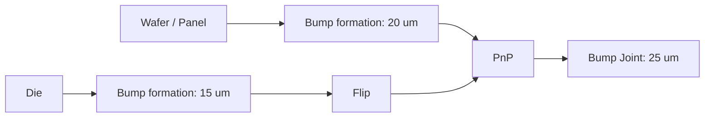

# Process Step catalog

本 catalog 說明 repository 目前提供的 operation modules。下表的 parameter 欄只列 Python
program 實際讀取的 domain parameters，不等同現行 fixture 的完整 definition。Fixture 仍是
目前 ports/id 的實作輸入，而 Python module 是 behavior source of truth；fixtures 額外宣告的
legacy `workingTemp` 屬 [DM-006](../../conformance.md)，不得複製到新 template。新增或修改
step 必須同步 module、target contract、fixture 與 tests。

| Operation | Program | Geometry inputs | Program 實際讀取的 parameters | Effect |
| --- | --- | --- | --- | --- |
| molding | `layer/molding` | `main_geometry` | `material`, `thickness` | 依 current footprint deposit body 並前進 cursor |
| ECL | `layer/ecl` | `main_geometry` | `material`, `thk`, `koz` | 以 footprint inset deposit ECL body |
| RDL layer | `layer/rdl` | `main_geometry` | `layers` | 逐層建立 dielectric body；奇數層建立 via、偶數層建立 circuit |
| Grinding | `grinding/grinding` | `main_geometry` | `thk` | 以整體 geometry top 減去厚度計算 target Z 並 grind |
| saw | `saw/saw` | `main_geometry` | `bottomLeftX/Y`, `topRightX/Y` | XY clip 到指定 box |
| DAF | `layer/daf` | `main_geometry` | `material`, `thk` | 在整體 geometry top 建立 keyed DAF body |
| FOW | `layer/fow` | `main_geometry` | `material`, `thk` | 在整體 geometry top 建立 keyed FOW body；Debond 保留 FOW |
| Carrier Bond | `carrier/bond` | `main_geometry`, `carrier_geometry` | — | 保留 source body keys，將 carrier root direct bodies 疊到整體 geometry top |
| Debond | `carrier/debond` | `main_geometry` | — | 遞迴移除唯一頂層 carrier 與可選的相連同 footprint DAF |
| Flip | `flip/flip` | `main_geometry` | — | 以 XY plane flip、normalize Z min，反轉 via/bump direction |
| Under Fill | `uf/under_fill` | `main_geometry` | `material`, `thk`, `gap` | 填充 child bump cavities 與符合 gap 的 root regions |
| Micro Bump | `bump/uBump_formation` | `main_geometry` | `material`, `thk`, `density`, `koz` | 在 cursor 上方建立 `+z` bump feature |
| BGA Bump | `bump/bga_bump_formation` | `main_geometry` | `material`, `thk`, `density`, `koz` | 在 cursor 上方建立 `+z` bump feature |
| C4 Bump | `bump/c4_bump_formation` | `main_geometry` | `material`, `thk`, `density`, `koz` | 在 cursor 上方建立 `+z` bump feature |
| Bump Joint | `bump/bump_joint` | `main_geometry` | `bump_joined_height` | 接合 root 直屬 child 與 main 的 reflowed bumps，調整完整間距 |
| tmv | `tmv/tmv` | `main_geometry` | `thk`, `material`, `density` | 在 cursor 上方建立 `+z` via feature |
| PnP | `pnp/pnp` | `main_geometry`, `die_geometry` | `placements` | 依 explicit或primitive-default adapter materialize absolute rectangle/polygon target |

## 共同行為

每個 step template 都有 required primary `main_geometry` 與 output `result_geometry`。Auxiliary geometry 不是 parameter。Parameter validation 先由 compiler 執行，module 再 enforce operation-specific rules。

Material instance suffix 由 kernel 配置，module 不自行產生。所有 step output serialize 為 standard geometry structure。
只有需要 semantic interaction 的 body-producing steps 指定 registered key：molding=`molding`、
DAF=`daf`、FOW=`fow`；carrier catalog geometry 自行提供 `carrier`。Carrier Bond 不建立或改寫 body key。
ECL、RDL dielectric 與 underfill 不指定
body key。Key 可重複；唯一 body identity 仍使用 `id`。PnP 與 geometry transforms 保留來源 key。

### State transition matrix

| Operation | Cursor | Process footprint | Scope / geometry side effect |
| --- | --- | --- | --- |
| molding、ECL | 前進新增層厚度 | 不變 | 在 target scope 新增 body。 |
| RDL layer | 依 `items[]` order 前進各層 `thk` | 不變 | 新增 dielectric bodies 與交錯的 via/circuit features。 |
| Grinding | Clamp 到 grind target Z | 不變 | Grind target scope；可能移除或截短 primitives。 |
| saw | 不變 | 改成指定 box | 對 target scope subtree 做 XY clip。 |
| DAF | 前進新增 DAF 厚度 | 不變 | 在 overall geometry top 使用 current footprint 新增 keyed DAF body。 |
| FOW | 設為 overall geometry top 加上 FOW 厚度 | 不變 | 使用 current footprint 新增 key=`fow` 的 body。 |
| Carrier Bond | 設為 bonded direct bodies 的 top Z | 不變 | 在 overall geometry top copy source root direct bodies 並保留 keys；不複製 children/features。 |
| Debond | 設為移除 carrier／DAF 後的 overall geometry top Z | 不變 | 驗證成功後原子性移除一個頂層 carrier 與零或一個相連 DAF；保留空 container。 |
| Flip | 設為 normalized 後的 root direct-body top Z | 不變 | 以 Z plane flip 全 subtree，normalize min Z，反轉 via/bump direction。 |
| Under Fill | 不變 | 不變 | 新增 child cavity/root gap fill bodies。 |
| Micro/BGA/C4 Bump | 不變 | 不變 | 在 cursor 上方新增 `stage="reflowed"` bump envelope。 |
| Bump Joint | 不變 | 不變 | 上側 bump 改成 joined 並涵蓋完整接合間距；平移 child subtree，下側 bump 原始資料保留。 |
| tmv | 不變 | 不變 | 以 current footprint 在 cursor 上方新增 via envelope。 |
| PnP | 不變 | 不變 | 依placements order將absolute target轉為adapter-local frame整批adapt；全部成功後attach到target center。 |

## 重要 operation 說明

- Micro／BGA／C4 formation 視為完成單側回焊成形，明確建立 `stage="reflowed"` 的 bump，
  不提供 stage parameter，適用 die、wafer 與 panel。PnP 保留來源 bump stage；獨立
  `bump/bump_joint` 完成後才將上側 bump 標記 `joined`。
  若整批沒有可配對的 reflowed bumps（包含 PnP 為 `placements: []`），Joint 正常完成並
  回傳未修改的 state；geometry、ID、cursor 與 process footprint 均不變。
  `bump_joined_height` 仍須為正有限數值；部分配對、多重匹配、跨層及高度不一致仍報錯，
  且整批驗證失敗時不修改 state。
- `molding` 需要既有 process footprint 與正的 thickness。
- ECL `koz` 在此 operation 直接用作 body footprint inset；這與 feature payload 中保存、交由 consumer 解讀的 `koz` 不同。
- RDL `layers` 是 repeatable group；每 item 必須含 stable `itemId`，runtime normalized item 另含 `_itemId`/`_index`。
- Grinding 的 `thk` 是移除厚度，不是 absolute target Z。
- Saw 不接受 empty/inverted XY box。
- Saw 對 Box/Polygon 支援 partial clip；Polygon 使用 `1e-5 um` precision grid，支援凹形、holes、
  multiple hulls 與裁切後的 multiple islands。Cylinder/Cone 只有全包含或完全分離，partial XY
  intersection 會 reject。
- ECL 的 non-zero `koz` 會作為 XY inset；Polygon process footprint 目前不支援此 inset。
- DAF 要求正的 `thk` 與非空 `material`，使用 current process footprint 在 target overall
  geometry maximum Z 建立 key=`daf` 的 body。
- FOW 的成層行為與 DAF 相同，要求有限正值 `thk`（um）與非空 `material`，但使用
  key=`fow`；Debond 不移除此層。材料 instance 名稱沿用 kernel 的配置規則。
- FOW template 為 `step_tpl_fow`（`V0.0.0`），參數為 `material`（FOW material）與
  `thk`（FOW thk），沒有預設值。新資料庫由 seed 載入；既有資料庫需透過
  `POST /api/process-step-templates` 新增 fixture 中的同一份 template，不需重設資料庫。
- Carrier Bond 要求 source root direct bodies 中至少一個使用 key=`carrier`，但允許 DAF 等其他
  registered body keys 並完整保留所有 source keys。它將 source direct-body minimum Z 對齊
  target overall geometry maximum Z；child containers、via/circuit/bump 都不複製。
- Debond 遞迴搜尋整棵 geometry tree，要求 exactly one key=`carrier` body 的 top Z 等於 overall
  geometry top；較低 carrier 保留，其他 body／feature／child 可與 carrier 同高。它只配對 top Z
  接觸 carrier bottom 的 key=`daf` body：沒有時只移除 carrier，恰好一個時還必須具有相同 primitive
  type 與 XY footprint，多個相連 DAF 或 footprint 不同都會失敗。非相連 DAF 保留；carrier 與 DAF
  可屬於不同 containers。任何 validation 失敗時 geometry、cursor 與 process footprint 都不變。
- PnP placement將absolute `targetRegion`（rectangle或simple polygon）、required
  `pose.x/y/rotationZ`與required `anchor`保存在同一item。Rectangle使用`bottomLeftX/Y`與
  `topRightX/Y`；polygon points也是global XY。Hidden transform固定為zero pose與center anchor，
  無底部 deposited/reflowed bump 時，bottom Z 對齊 current cursor 並忽略 main bump。
  有底部 deposited/reflowed bump 時，依實際 XY footprint 尋找涵蓋它、底面位於 cursor 的
  main deposited/reflowed bump；整體 envelope bottom 對齊 cursor 加 main bump 厚度，
  因此 die 本體底面為 cursor 加兩側 bump 厚度。Catalog main 沒有 runtime cursor 時，
  僅在 PnP 還原到 root direct-body top，不以 bump 或 children 的最高點定位。
- Missing contract的Box-only subtree使用`box-rescale@1`；exactly one single-loop
  PolygonGeometry使用`polygon-rescale@1`。Mixed、empty、multiple-loop、Cylinder/Cone source
  要求explicit contract。
- 同一個PnP `placements[]`可交錯rectangle與polygon target。`box-rescale@1`的rectangle target
  維持Box-only全樹additive resize；polygon target將所有root direct body/via/circuit/bump改成
  exact target polygon並保留各自Z、thickness與metadata。Children不rescale、不檢查containment，
  只跟absolute target frame做rigid translation。
- Built-in explicit contracts另有`hbm-package@1`、`dram-package@1`與`rigid@1`。Polygon target
  必須unique、無zero-length edge、non-zero-area且不得self-intersect；HBM/DRAM fixed children
  必須完整位於target內。Unknown adapter id/version明確失敗。
- PnP先完成整個placements batch的validation/materialization；任一筆失敗時不得attach任何child。
- Bump feature envelope 不會預先套用 `koz`；各 exporter 的 current behavior 見 [geometry-semantics.md](../../concepts/geometry-semantics.md)。
- TMV 需要既有 process footprint、正的 `thk`、非空 `material` 與 `0` 到 `100`（含端點）的 `density`；輸出的 via direction 固定為 `+z`、`koz` 為 `0`，且不推進 cursor。

## 開發與驗證

### 雙側 bump study 範例

Seed 的 `flow_tpl_dual_bump_demo` 與 `flow_inst_dual_bump_demo` 展示完整雙分支：

Formation 使用各自 state footprint，不需要單顆 bump 座標。PnP 後 die 本體與 main
接合表面間距為 35 um；Joint 後為 25 um。下側 envelope 涵蓋上側 footprint 且 Z 面接觸
即可配對，不要求 material 或 density 相同；joined metadata 沿用 die 側。

Joint 只處理 root 直屬 children 的最底部 reflowed bumps，略過未配對 children；完全沒有
配對時失敗。每個上側 envelope 必須有唯一配對，同一 child 的底部 bumps 必須全部配對
且頂面一致。所有配對的下側底面與上下接觸面須同高（1e-5 um tolerance），不同 child
的上側厚度可以不同。全部驗證成功後，將上側 bump 底面移到下側底面、厚度設定成
正值 `bump_joined_height`，並整體平移 child，使本體底面到達下側底面加 joined height。
下側資料保留；失敗時 geometry、cursor、footprint 均不變。不限制體積守恆或高度縮減比例。

新 template 與範例只加入 seed；已有本機資料庫須自行建立或匯入 template，不自動修改
既有資料或插入 Joint。consumer ownership 與顯示規則見 [geometry semantics](../../concepts/geometry-semantics.md)。

新增 operation 前先讀 [Process Step Authoring Guide](../kernel/process-step-authoring.md)。最低驗收為 template graph validation、module resolution、valid execution、invalid input、serialization round trip，以及會受影響的 CAD/CDB consumer test。
