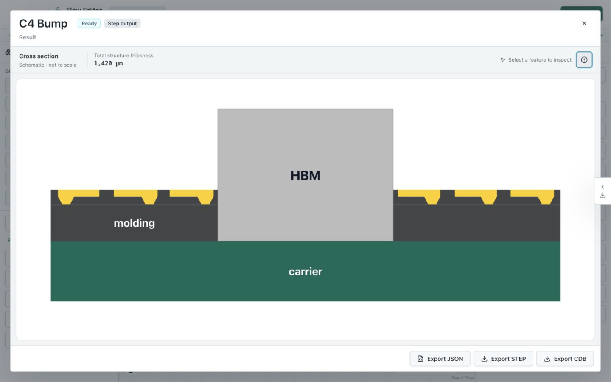
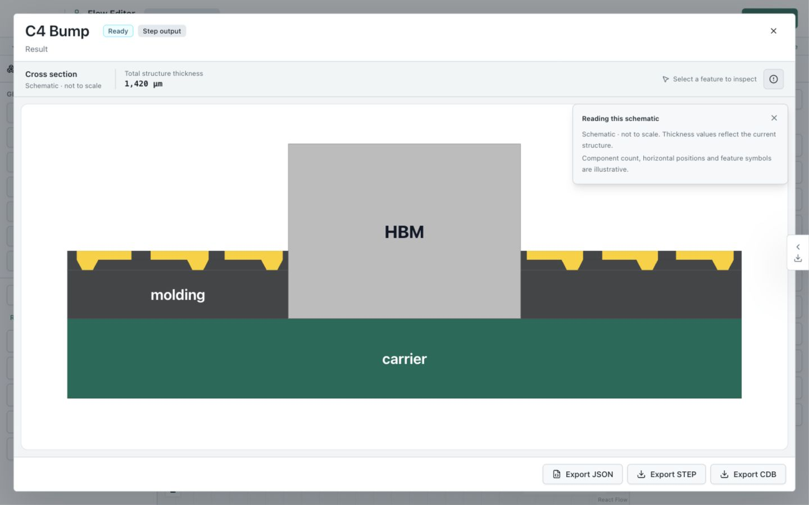
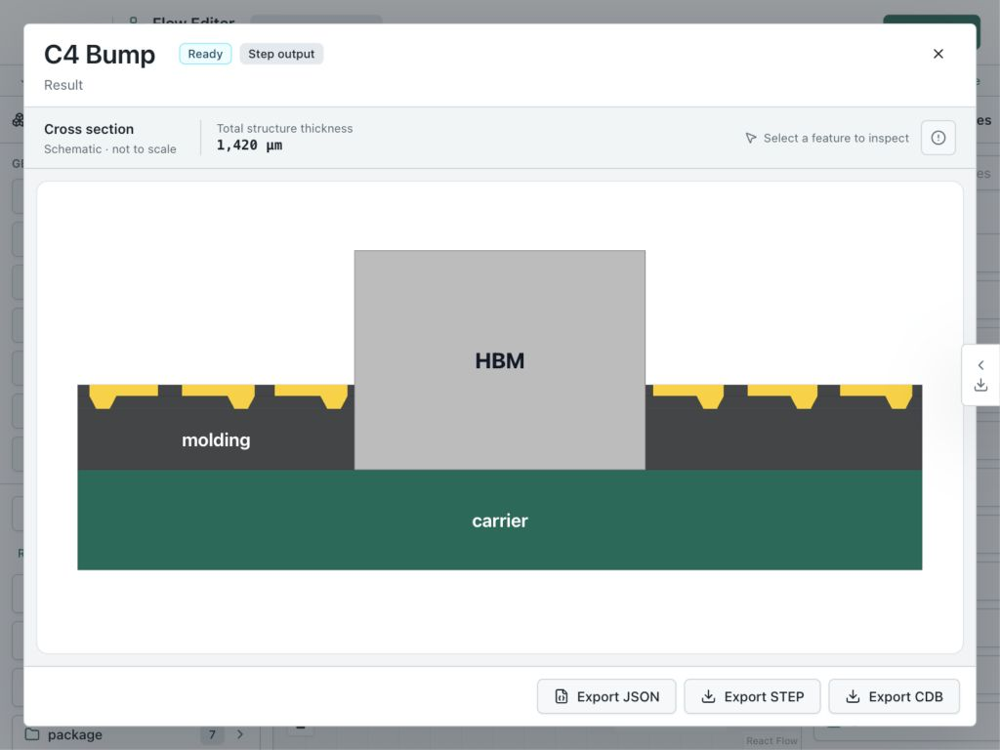
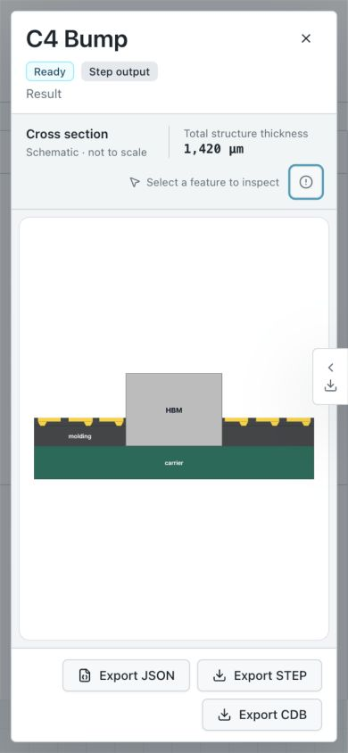
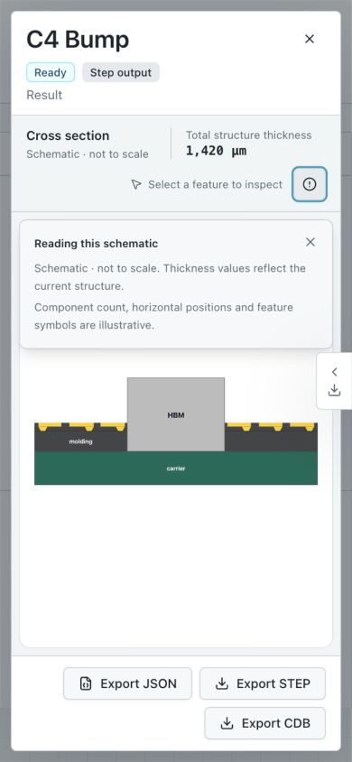

# Schematic Notes Disclosure Evidence

以現有 `HBM4 Alpha Build` 的 `C4 Bump` output 在本機瀏覽器驗證
`UI-SCHEMATIC-007` 與 `UI-SCHEMATIC-017`；未 reset、儲存或修改 flow。
這些截圖是 current observation，不是 canonical reference。

右上角 Lucide `AlertCircle` 按鈕預設收合 notes。滑鼠、Enter 與 Space 皆可開啟；
再次點擊、卡內 Close、點外部、Escape 與選取 feature 可關閉。Close／Escape 還原
按鈕焦點，第一次 Escape 保留 preview。Notes 與 feature details 互相切換，不同時開啟。

`1440×900` 的 SVG 可用區為 `1348×599`，開關說明卡尺寸相同；`1024×768` 為
`932×467`；`390×844` 為 `338×465`。保留完整 document viewBox 與
`xMidYMid meet`，結構完整可見；手機與 compact 均無 document 水平 overflow。
手機說明卡寬 `348px`，位於 x `21..369`，未超出 viewport。

針對 schematic、snapshot content 與 process warnings 的測試共 34 項通過；
另 2 項既有 inspector dock 測試因 `SchematicInspectorCard` 缺少 export 而失敗，
相同既有問題見 [selection evidence](../schematic-selection/README.md)。
修改檔的 ESLint 與文件驗證通過。此 observation 未涵蓋完整 preview 驗收。
