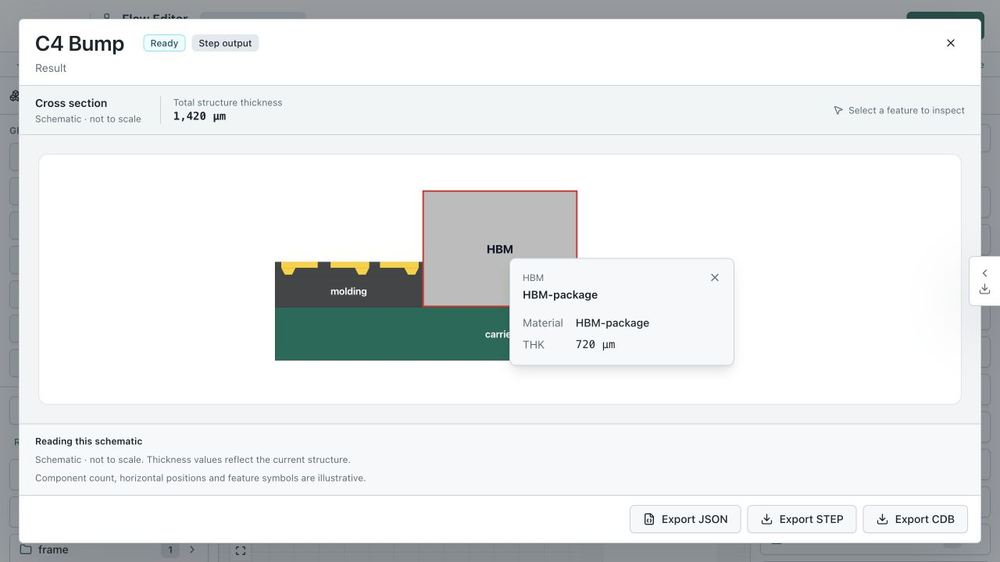

# Schematic Selection Evidence

於 `1280×720` 瀏覽器開啟 `/flow-editor?flowId=flow_inst_aaa_demo_hbm4_alpha`，
以現有 `HBM4 Alpha Build` 的 `C4 Bump` output 開啟 Geometry Preview，未重設或儲存資料。
本次觀察對應 `UI-SCHEMATIC-005`，完整 preview 驗收仍由 `PV-007` 追蹤。

滑鼠選取 carrier，再以 Enter 選取 HBM-package。預期與實際皆為紅色粗框、淡外暈，
保留材料填色；鍵盤選取沒有恢復綠框。瀏覽器 computed style 確認選取 stroke 為
`rgb(220, 40, 40)`、stroke-width `4px`、`non-scaling-stroke`，外暈 alpha 為 `0.3`。

此圖是 current observation，不是 canonical reference。未涵蓋完整多 viewport 驗收。
Lint 與文件檢查通過；schematic 測試 26 項通過。另 2 項 inspector dock 測試因
`SchematicInspectorCard` 缺少 export 而失敗，已在乾淨 HEAD `886ad764` 重現相同錯誤。
