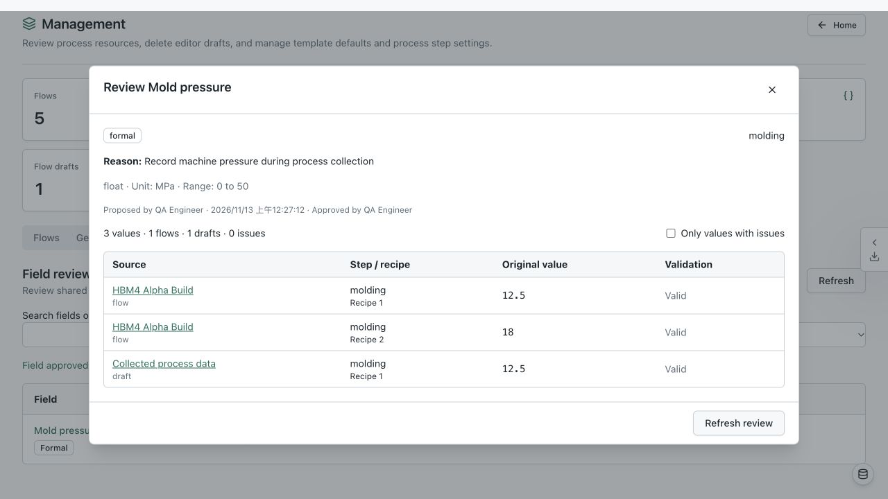

# Shared data fields verification

Verified 2026-11-13, working tree based on `397cdb08`.
Browser checks used isolated SQLite databases in `/tmp` and local API/viewer ports 8017/3017.
No existing business database was changed.

Verified in the browser:

- Create a shared proposed numeric field directly from a recipe.
- Save and reload a non-numeric proposed value; review displays its issue and disables approval.
- Follow the review link to the exact recipe without introducing unsaved changes.
- Correct the value and save it independently of geometry parameters.
- Collect data in a new incomplete flow by first creating a draft.
- Review both the saved flow and draft, then approve the field as formal.
- Add another candidate to an existing flow: Save data opens Save flow, then returns with the data input retained for submission.
- Review includes the inactive candidate and draft after approval.

Automated coverage:

- `apps/api/tests/test_data_fields.py`: soft/strict validation, zero/false, all candidates/drafts, revisions, approval/removal rollback, concurrent connections, import/ZIP preservation, schema upgrade backup, geometry compiler inputs, stale metadata writes.
- `apps/viewer/components/data-fields/data-fields.test.tsx`: failed-save retry, formal rules on refresh, draft identity, false values, review source links, invalid approval prevention and removal confirmation.
- Existing flow, template-transfer and save-dialog regression tests pass.

Known baseline failures were reproduced from unmodified `397cdb08`:

- API: schema 11/13 geometry digest expectations, joint/TIM CDB export, polygon validation call count.
- Viewer: two `schematic-preview.test.tsx` cases import the absent `SchematicInspectorCard` export.
- TypeScript: that missing export and two existing `flow-editor-source.test.ts` fixture/type errors.
