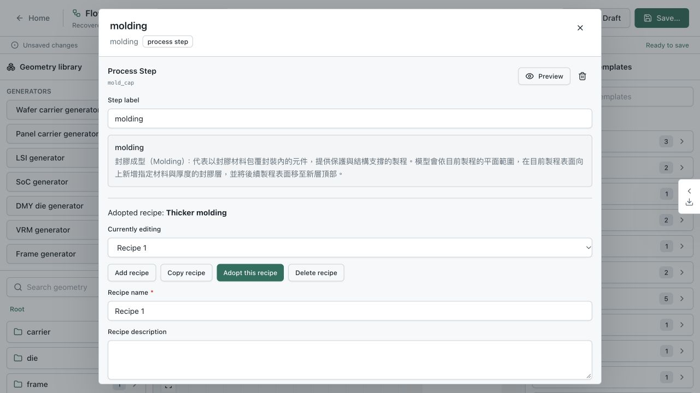

# Unified ProcessFlow 驗證紀錄

本次驗證對應 `feature/new_structure` 工作目錄的 schema 3 ProcessFlow、schema 2 FlowDraft 與 SQLite 14 重構。沒有加入 flow lifecycle、啟停狀態、template/product 分類或歷史版本內容。

## Browser 操作

使用獨立測試資料庫 `/private/tmp/process-flow-v14-ui.sqlite3`、API port 18000、Viewer port 13000。沒有 reset 或修改日常使用的 SQLite。1280×720 截圖是操作證據，不是完整 responsive/pixel regression baseline。

| Acceptance | 實際操作與觀察 |
| --- | --- |
| UI-FLOW-001 | 空畫布加入 molding、拖入 catalog geometry、接線並儲存；形成一個 input、一個 step 的正式 flow。刪除採用候選後仍可保存未完成設定。 |
| UI-FLOW-002 | 新站點自動建立並採用 Recipe 1；Copy 得到獨立候選，修改 name、description、thickness。Adopt 後再查看 Recipe 1，採用仍是 Thicker molding。另驗證 Add recipe 帶 defaults 且不切換採用，刪除採用後顯示 None selected、Preview 停用。 |
| UI-FLOW-003 | 儲存與重載保留兩組值和採用。最終 Recipe 1 thickness=190、Thicker molding=220，採用後者。獨立讀取測試 SQLite 核對 persisted payload。 |
| UI-FLOW-004 | 刪除 C4 node 後更新 flow，definition 與 stepConfigurations 同步少一站；來源仍保留原內容。另存記錄直接來源 revision 1，副本更新至 revision 2。來源更新／刪除隔離另有 API regression。 |
| UI-FLOW-005 | 保存 Recipe viewing draft，再從 Management → Drafts → Resume；畫布、viewport、目前查看 Recipe 1、採用 Thicker molding 與原 target revision 均保留。 |
| UI-FLOW-006 | 第二分頁將來源更新至 revision 2；第一分頁以 revision 1 commit 得到 409，recipe 編輯內容與草稿保留。選 Save as new flow 成功，原草稿在 transaction 成功後刪除。 |
| UI-FLOW-007 | molding 上游局部預覽成功，bounds 為 310000×310000×1420，採用 thickness=220。JSON、STEP、CDB 三種工作皆完成，CDB 為 32 elements／80 nodes／4 components，匯出檔實際存在且非空。 |
| UI-FLOW-008 | Recipe labels 同時呈現編輯／採用；鍵盤 Backspace 刪站同步清理 configuration。Preview／Export 取得初始焦點；Escape 僅關閉最上層 Export 並還原 trigger，Preview 與站點面板保持開啟。 |



Browser 環境沒有可用的 WebGL context，因此預覽使用既有 fallback。後端 geometry／CAD 與匯出已驗證；本次不把 3D hardware rendering 或完整三尺寸視覺矩陣記為通過。既有 geometry drag-only、compact pane 與其他 modal 的範圍仍見 [conformance](../../../conformance.md)。

## 自動檢查

執行 Python API 測試時固定 `PROCESS_FLOW_API_DB_PATH=:memory:`，避免 module import 建立預設 app 時開啟日常資料庫。

```sh
PROCESS_FLOW_API_DB_PATH=:memory: venv/bin/python -m pytest packages/kernel-py/tests packages/mesh-control-py/tests packages/geometry_generators/tests -q
PROCESS_FLOW_API_DB_PATH=:memory: venv/bin/python -m pytest apps/api/tests/test_process_flows.py apps/api/tests/test_flow_migration.py -q
cd apps/viewer
npm test
npm run build
```

- Kernel、mesh-control package 與 geometry-generators package：243 tests、1105 subtests 通過。
- Viewer：37 files、367 tests 通過；production build、TypeScript 與 lint 檢查通過。
- API 完整集合依下述 mesher 環境分開執行；流程契約、revision、draft rollback、ZIP、analytics history、preview、匯出及 migration 均有覆蓋。
- Migration 使用 schema 8／9／11／13 測試資料庫，涵蓋備份、兩種草稿及舊 workspace、bound/unbound embedded 轉 catalog、跨集合衝突、交易失敗與重啟。三個 legacy instance 的完整 geometry、step outputs 與 terminal IDs，以舊 commit `7d49bf0b` 未修改 compiler/kernel 生成的 digest 為基準；11／13 升級後全部一致。基準保存在 `apps/api/tests/fixtures/schema13/execution-digests.json`。
- `scripts/check_docs.py` 與 `scripts/check_golden_example.py` 驗證文件連結、截圖尺寸和可執行 golden example。

### Mesher 相依版本限制

Repository README 指定的 mesher commit `302ebe36663b727669901cbc766ccc0a2ae6f221` 與本機 editable mesher `03f1f37` 有既有 API 差異：

- 舊版提供 joint regression 使用的 `mesher.process_flow.pipeline`，但不接受較新的 mesh-control `coordinateMode`／`label` 欄位。
- 本機新版已移除該 pipeline，且新 Z-control 已支援，與現有兩項預期舊 worker 拒絕新 controls 的測試不同。

因此將指定舊 commit 用 `git archive` 展開到 `/private/tmp/process-flow-mesher-pinned`，只透過測試行程的 `PYTHONPATH` 使用，沒有修改本機 mesher checkout 或放寬測試：

```sh
PYTHONPATH=/private/tmp/process-flow-mesher-pinned/src PROCESS_FLOW_API_DB_PATH=:memory: venv/bin/python -m pytest apps/api/tests --ignore=apps/api/tests/test_mesh_control_sets.py -q
PROCESS_FLOW_API_DB_PATH=:memory: venv/bin/python -m pytest apps/api/tests/test_mesh_control_sets.py -q
```

舊版環境通過 235 tests／592 subtests，新版 mesh-control 集合通過 10 tests／49 subtests；這不代表單一 mesher 環境下的完整 API suite 已全綠。統一 mesher dependency baseline 應獨立處理，不能以跳過失敗 assertion 代替。

## 真實 SQLite 副本

先用 SQLite backup API 將日常資料庫複製到 `/private/tmp/process-flow-real-upgrade-validation.sqlite3`。副本 marker 是已明確排除的 **schema 15**，初始化依規格拒絕 `15 → 14`，沒有嘗試改 marker 或重置資料。原始資料庫未變更。此環境沒有可供實際升級的 schema 11／13 日常資料庫；這兩條路徑由上述 fixture migration 和舊執行結果基準驗證。
